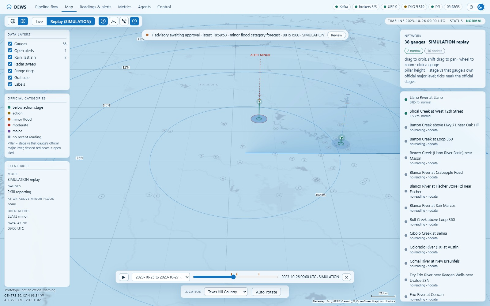
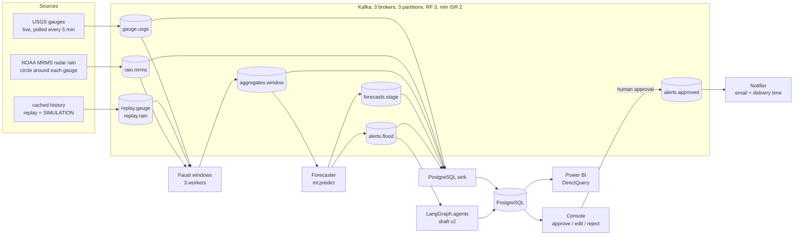

# DEWS: real-time flood and flash-flood forecasting and alerting on Apache Kafka

DEWS (Disaster Early Warning System) streams live river-gauge readings and radar rainfall through Apache Kafka,
forecasts whether each gauge will cross one of its **official NWS flood categories** within the next few hours, and
turns each alert into a checked, plain-language advisory that **a person must approve** before anything is sent.
Every step is timestamped, so the end-to-end delay, including the public feed's own delay, is measured, not assumed.

By Aaditey Chalva, Amudhan S and Dhaksha Muthukumaran. MIT licensed.



*The console's map during a replay (mode SIMULATION) of 26 Oct 2023: radar rain discs around the gauges, and LLAT2's
minor-category alert raised while its stage was still below minor. More screenshots: [`docs/figures/console/`](docs/figures/console/README.md).*

## What it does

Flash floods rise in hours. A river gauge records the water level every 5 to 15 minutes, but the public feed sends
those readings in batches, so part of any warning is gone before the data even arrives. DEWS:

1. **Streams** live USGS river-gauge readings for 38 Texas Hill Country gauges and NOAA MRMS radar rainfall around
   each gauge into Kafka as soon as they are published.
2. **Builds hourly windows** per gauge in Faust (a Python stream processor) on the reading's own timestamp. It fills
   silent hours and handles late revisions; a killed worker's state is rebuilt from changelog topics.
3. **Forecasts** the stage up to 6 h ahead and raises an alert when the forecast reaches one of the gauge's official
   categories (action, minor, moderate, major). It never uses thresholds of its own.
4. **Drafts an advisory**: a fixed template within seconds, then a LangGraph multi-agent writer whose reviewer checks
   every number against the evidence. **A person approves, edits or rejects it** in the console; only then does the
   notifier send the email.

**Wording we keep to:** DEWS gives a *forecast that a gauge will cross an official flood category* within a horizon,
with a probability when the model has one. It does not "predict a flood", flooded areas or damage, and it does not
issue official warnings. It is a decision-support prototype, not an official warning service.
[Concepts](docs/guide/01-concepts.md) explains why.

## Architecture



The sink also writes the template advisory (v1) the moment an alert lands. The agents read PostgreSQL only: they never
publish to Kafka and never send anything. Only the notifier sends, and it reads only `alerts.approved`. Failed
deliveries go to `deadletter.flood`. Design notes: [`docs/architecture.md`](docs/architecture.md); record fields and
tables: [`docs/CONTRACTS.md`](docs/CONTRACTS.md).

## Real data vs SIMULATION

| Data | Where it comes from | Label |
|---|---|---|
| Live gauge readings, 38 Texas Hill Country gauges | USGS Instantaneous Values, polled every 5 min | `mode = LIVE` |
| Live radar rain around each gauge | NOAA MRMS on the AWS Open Data registry | `mode = LIVE` |
| Official flood categories per gauge | NOAA NWPS (`config/gauge_locations.csv`) | real |
| Past floods replayed for demos and evaluation (e.g. Onion Creek, May 2019; Shoal Creek and Llano River, Oct 2023) | cached USGS and MRMS history | `mode = SIMULATION`, own topics |
| Seeded agent test alert (`python -m agentic_ai.seed`) | the measured May 2019 USGS record, run through the pipeline's own window and forecast code | `mode = SIMULATION` |

Replayed data is labelled SIMULATION all the way through: in topics, tables, alerts and the advisory text. Live and
replay results are always reported separately.

## Status and measured results

Every number below was measured on **replayed** USGS history (mode SIMULATION) unless it says LIVE. No flood occurred
at the 38 gauges while the system ran live, so **there is no live detection result**. Each row names the committed
file that holds the number.

| Part | Measured | Source |
|---|---|---|
| Kafka stack | 3 brokers (KRaft), 9 topics, RF 3, min ISR 2 | `docker/docker-compose.yml` |
| Windows | May 2019 DRWT2 replay: 119 hourly windows, none emitted twice | [`docs/paper/03-results.md`](docs/paper/03-results.md) |
| PostgreSQL sink | killed mid-replay and restarted: 4233/4233 readings, 0 gaps, 0 duplicates | same |
| Fault drills | recovery after restart, one run each: Faust worker 18.1 s, broker 21.1 s, sink 5.4 s, PostgreSQL 3.9 s, notifier 1.1 s, live producer 4.2 s; all loss and duplication checks passed | same |
| Latency | 167 traces through the running stack: ingest median 0.066 s, forecast 0.506 s, one alert 1.07 s | same |
| Live feed delay (LIVE) | 31.4 h of polls (370 polls, 38 gauges): reading to availability median 23.4 min, p95 68.3 min, max 123.0 min | [`docs/paper/02-data.md`](docs/paper/02-data.md) §2.5 |
| Radar rain publication (LIVE) | after the hour: RadarOnly about 3 min, Pass 1 about 15 min, Pass 2 about 57 min | same, §2.3 |
| Forecaster `s3_v0` (gradient boosting on stage, active at 3 h; rise-rate rule at other horizons and on any failure) | test period 2024-01 to 2026-10 (63 minor crossings): F1 0.24 vs 0.21 for rise-rate, **150 vs 224 false alarms**, 29 vs 33 crossings detected. **No lead-time gain**: median 0.42 h gross, −0.58 h net of the 1 h feed delay (rise-rate 0.50 / −0.50) | [`ml/MODEL_CARD.md`](ml/MODEL_CARD.md), `ml/figures/s3_eval.csv` |
| Forecaster `s3_v1` (stage + radar rain) | below `s3_v0` at 1 to 3 h and never above rise-rate: **adding rain did not help** | same |
| Sensor-fault rules | faults injected into real 2024-26 series: no readings 100 % detected, step 81.4 %, stuck 29.5 %; 0 to 0.49 % of flood windows falsely flagged. An Isolation Forest is kept as a negative result | `ml/figures/fault_rules_test.csv`, [`ml/MODEL_CARD.md`](ml/MODEL_CARD.md) §2 |
| Agents | 9 alerts from 9 replayed floods, live Groq `openai/gpt-oss-120b`: multi-agent 9/9 pass every deterministic check (single agent 6/9), 142/142 numbers found in the evidence, UNCERTAIN in 8 of 8 cases that needed it, median 3376 tokens and 2.7 s per advisory; with an independent Gemini judge 9/9; the reviewer caught 135 of 135 seeded errors; with the LLM down, 9/9 kept the template draft | [`agentic_ai/eval/agent_eval.md`](agentic_ai/eval/agent_eval.md) |

**In one sentence:** the model gives comparable detection with about a third fewer false alarms than the rise-rate
rule on the 2024-26 test period, but no extra warning time; on these fast-rising gauges, an hourly public feed eats
most of the lead time. **The bar** any model must beat is rise-rate extrapolation at 3 h, scored on stream windows (38
gauges, 2015 to 2025, 310 minor crossings): pooled F1 0.28, median warning 0.8 h gross, −0.2 h net
([`ml/REFERENCE_BASELINES.md`](ml/REFERENCE_BASELINES.md)).

DEWS is not compared with, and makes no claim against, NWS, NSSL FLASH or GloFAS forecasts.

## Quick start

Windows, PowerShell, from the repo root. Docker Desktop and Python 3.12 are needed. Full steps, including Linux and
macOS, are in [Setup](docs/guide/02-setup.md).

```powershell
py -3.12 -m venv .venv; .venv\Scripts\Activate.ps1
python -m pip install -U pip setuptools wheel
pip install -r requirements-dev.txt          # everything: pipeline, ML, agents, tests
pytest -q                                    # PostgreSQL tests skip without AGENTS_TEST_DSN
copy .env.example .env                       # then fill in; never commit .env
cd docker; docker compose up -d; cd ..       # 3 Kafka brokers + PostgreSQL (tables and views load on first start)
python -m dashboard.flow_monitor             # console at http://127.0.0.1:8765
```

No Docker yet? `python -m dashboard.flow_monitor --demo` shows the console on scripted data. The database user and
password in `docker/docker-compose.yml` are local demo defaults: change them before exposing anything
([Setup](docs/guide/02-setup.md#2-start-kafka-and-postgresql)). Next, replay a past flood end to end:
[Run a demo](docs/guide/03-run-a-demo.md). LLM agents are optional: with `LLM_PROVIDER=none` they run on
deterministic text.

## Documentation

| | |
|---|---|
| [01 Concepts](docs/guide/01-concepts.md) | Kafka topics, partitions and consumer groups as used here; windows; official flood categories |
| [02 Setup](docs/guide/02-setup.md) | Python, Docker, `.env` (every variable), Linux/macOS notes |
| [03 Run a demo](docs/guide/03-run-a-demo.md) | replay a past flood and approve an alert |
| [04 Console tour](docs/guide/04-console-tour.md) | what each tab shows and how to read it |
| [05 Power BI](docs/guide/05-power-bi.md) | the analytics report (`dashboard/powerbi/DEWS.pbip`) on the same PostgreSQL |
| [06 ML and evaluation](docs/guide/06-ml-and-evaluation.md) | baselines, the model, how it is scored honestly |
| [07 Agents](docs/guide/07-agents.md) | the LangGraph multi-agent advisory writer and its reviewer |
| [08 Troubleshooting](docs/guide/08-troubleshooting.md) | known issues and fixes |
| [09 Repo map](docs/guide/09-repo-map.md) | folder by folder, and every command |

Also: [`docs/RUNBOOK.md`](docs/RUNBOOK.md) (operations: start, check, replay, recover), [`docs/DEMO.md`](docs/DEMO.md)
(demo script), [`docs/CONTRACTS.md`](docs/CONTRACTS.md) (interfaces), [`FAQ.md`](FAQ.md) (why things are the way they
are), [`docs/EDA_WALKTHROUGH.md`](docs/EDA_WALKTHROUGH.md) (the EDA notebooks explained),
[`docs/paper/`](docs/paper/README.md) (a technical write-up draft with a source for every number),
[`docs/references.md`](docs/references.md). How to contribute: [CONTRIBUTING.md](CONTRIBUTING.md).

## Data sources and their terms

The data are not part of this repository's code and come under their providers' own terms:

- **USGS Water Services** (Instantaneous Values): U.S. public-domain data. Recent values are provisional and may be
  revised.
- **NOAA National Water Prediction Service** (official flood categories) and **NOAA MRMS** radar rainfall from the
  AWS Open Data registry (`noaa-mrms-pds`): U.S. government data, public domain.
- **Map imagery** in the console: Esri World Imagery and Canvas tiles and AWS Terrain Tiles, loaded at run time under
  their providers' terms; the offline fallback is NASA's Blue Marble (public domain). Leaflet is bundled under its
  own licence (`dashboard/static/leaflet/LICENSE`).

DEWS is not affiliated with or endorsed by any of these agencies or providers, and it is not an official warning
service.

## Licence

The code and documentation are released under the [MIT License](LICENSE), copyright 2026 Aaditey Chalva, Amudhan S,
Dhaksha Muthukumaran. The licence covers this repository's code and documentation only; the data sources above keep
their own terms.
