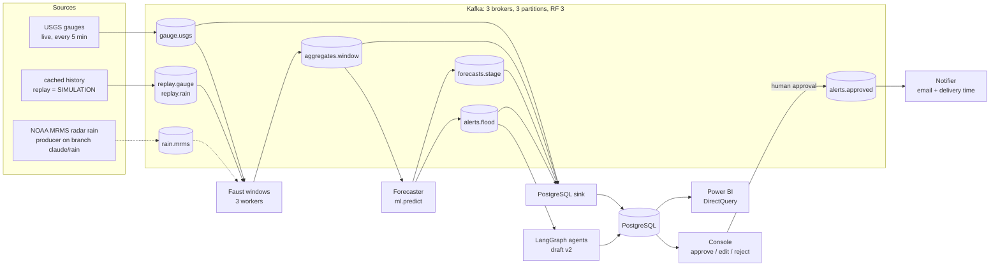

# DEWS: real-time flood and flash-flood forecasting and alerting on Apache Kafka

Team: Aaditey Chalva, Amudhan S, Dhaksha Muthukumaran. Mentors: Dr. Vijayalakshmi M. N., Dr. Anupama Kumar.

> **Status: work in progress (October 2026).** The streaming pipeline runs end to end on replayed history. The
> forecaster is still a simple baseline, and **no forecast skill is claimed yet**. See [Status](#status) for what was
> measured.

## What it does, in plain words

Flash floods rise in hours. A river gauge records the water level every 5 to 15 minutes, but the public feed sends
those readings about once an hour, so part of any warning is gone before the data even arrives. DEWS does four things:

1. **Streams** live river-gauge readings (USGS) and, later, radar rainfall (NOAA MRMS) through Apache Kafka as soon as
   they are published.
2. **Builds hourly windows** per gauge in Faust (a Python stream processor). It uses the reading's own timestamp,
   fills silent hours and handles late revisions.
3. **Forecasts** the river stage a few hours ahead. When the forecast reaches one of the gauge's **official NWS flood
   categories** (action, minor, moderate, major), it raises an alert. We never set our own thresholds.
4. **Drafts an advisory**, first from a fixed template within seconds and then from a team of LLM agents that check
   the evidence. **A person must approve it**, and only then does the notifier send the email. Every step is
   timestamped, so the end-to-end delay, including the feed's own delay, is measured, not assumed.

**Wording we keep to:** DEWS gives a *forecast that a gauge will cross an official flood category* within a horizon,
with a probability when the model has one. It does not "predict a flood", flooded areas or damage, and it does not
issue official warnings. It is a decision-support prototype for a duty officer.
[Concepts](docs/guide/01-concepts.md) explains why.

## Architecture



Dashed lines are planned. The sink also writes the template advisory (v1) the moment an alert lands. The agents never
publish to Kafka and never send anything. Only the notifier sends, and it reads only `alerts.approved`.

## Real data vs SIMULATION

| Data | Where it comes from | Label |
|---|---|---|
| Live gauge readings, 38 Texas Hill Country gauges | USGS Instantaneous Values, polled every 5 min | `mode = LIVE` |
| Official flood categories per gauge | NOAA NWPS (`config/gauge_locations.csv`) | real |
| Past floods replayed for the demo and evaluation (e.g. Onion Creek, May 2019) | cached USGS history | `mode = SIMULATION`, own topics |
| Seeded agent test alert (`python -m agentic_ai.seed`) | the measured May 2019 USGS record, run through the pipeline's own window and forecast code | `mode = SIMULATION` |
| India study inputs (India-WRIS exports, synthetic "ideal India") | manual downloads / generator | `mode = SIMULATION` |

Replayed and synthetic data are labelled SIMULATION all the way through: in topics, tables, alerts and the advisory
text. Live and replay results are always reported separately.

## Status

Only measured results are listed. Source: commit messages and `docs/breadcrumbs/`. Slice plan: `docs/SLICES.md`.

| Part | State | Measured |
|---|---|---|
| Kafka stack | done | 3 brokers (KRaft), 9 topics, RF 3, min ISR 2 |
| USGS live producer | done | dedupe by sensor series, heartbeats, backfill after a 34 h outage |
| Faust windows (3 workers) | done | May 2019 replay: 119 hourly windows, no window emitted twice |
| PostgreSQL sink | done | killed mid-replay and restarted: 4233/4233 readings, 0 gaps, 0 duplicates |
| Fault drills (`tools.fault_drill`) | done, 6 scenarios | recovery after restart: Faust worker 18.1 s, broker 21.1 s, sink 5.4 s, PostgreSQL 3.9 s, notifier 1.1 s, live producer 4.2 s; all checks PASS (one run each, replay) |
| Forecaster | done; `s3_v0` (gradient boosting, stage only) active at the 3 h horizon, rise-rate rule at every other horizon and on any failure | test period 2024-26 (replay, 63 minor crossings): **comparable detection with about a third fewer false alarms** than rise-rate (29 vs 33 detected, 150 vs 224 false alarms), no lead-time gain (median 0.42 h gross, −0.58 h net). Not "better forecasts". On the 2019 DRWT2 replay the rise-rate baseline alerted only after the minor crossing |
| Template advisory, console approval, notifier | done | an approved replayed advisory was emailed and its delivery time recorded (runbook step 11) |
| Console | done: landing page, Pipeline flow, Map (globe and flat), Readings & alerts, Metrics, Agents | |
| Agents (LangGraph) | S1 + S2 code done | live Groq `openai/gpt-oss-120b`, reasoning effort low, 5 runs on the 2019 DRWT2 alert (replay): 5/5 passed the reviewer on the first attempt, 2.6 to 3.9 s, 3.1k to 3.5k tokens per advisory |
| ML models | v0 (stage) and v1 (stage + radar rain) trained on 2015-2020, thresholds on 2021-23, tested once on 2024-26 | **neither beats the rise-rate rule consistently; no forecast skill is claimed**; adding rain did not help (`ml/MODEL_CARD.md`) |
| Sensor-fault rules | 3 rules shipped (no readings, step, stuck); spike not shipped; Isolation Forest kept as a negative result | test 2024-26, faults injected into real series: no readings 100 % detected, step 81.4 %, stuck 29.5 %, 0 to 0.49 % of flood windows falsely flagged; spike 100 % but 1.07 % of flood windows (above the 1 % team limit) |
| MRMS rain | live and replay producer `producers/mrms_qpe_producer.py` on branch `claude/rain`, **not yet merged**; rain not yet joined into windows | read back from a real Kafka: 38 gauges per live poll; RadarOnly product in hand about 3 min after the hour, Pass 1 about 15 min. History: 102 floods + 102 dry windows decoded offline. No radar rain exists for floods before Oct 2020 (incl. the 2019 demo flood) |
| India data study | US side of Table 1 measured; India-WRIS API client works from an Indian connection | the two stations probed report **manual staff-gauge readings about once a day** (00:00 / 08:00); no Indian series processed through the pipeline yet |
| Power BI | page 1 guide written (`dashboard/powerbi/README.md`); report not built yet | |
| Latency trace | done | replay through the running stack, 167 traces: ingest median 0.066 s, forecast 0.506 s, one alert 1.07 s. Human approval and delivery: PostgreSQL test only. Live feed delay: one sample, 24 to 69 min |
| Slice check | `python -m tools.verify_slice S1` | first real run: 16 of 19 checks passed (before the S1 rule became "one alert per episode, lead time reported"); not re-run since |
| Tests | `pytest -q` | after merging core, ml-india and agents (1 Nov 2026, Python 3.12): 303 passed, 28 skipped, **7 failed** in `tests/test_forecaster.py`. Those tests assume the rise-rate rule, while `ml/models/active.json` now activates `s3_v0`; the fix is with core |

**The bar any model must beat** is rise-rate extrapolation at 3 h, scored by `ml/harness.py` on stream windows
(38 gauges, 2015 to 2025, replay): pooled F1 0.28 (precision 0.18, recall 0.61, 310 minor crossings), slow floods only
0.21; per gauge DRWT2 0.25, LCPT2 0.42, JNCT2 0.76, AHOT2 0.25; median warning 0.8 h gross, −0.2 h net of the 1 h feed
delay. *Corrected 31 Oct 2026: earlier figures (0.65 / 0.26 / 0.64 / 0.41) included a 1 h look-ahead; evidence in `ml/REFERENCE_BASELINES.md`.*

DEWS is not compared with, and makes no claim against, NWS, NSSL FLASH
or GloFAS forecasts.

## Quick start

Windows, PowerShell, from the repo root. Docker Desktop and Python 3.12 are needed. Full steps, including Linux and
macOS, are in [Setup](docs/guide/02-setup.md).

```powershell
py -3.12 -m venv .venv; .venv\Scripts\Activate.ps1
python -m pip install -U pip setuptools wheel
pip install -r requirements-dev.txt          # everything: pipeline, ML, agents, tests
pytest -q                                    # database tests skip without AGENTS_TEST_DSN (see Status for known failures)
copy .env.example .env                       # then fill in; never commit .env
cd docker; docker compose up -d; cd ..       # 3 Kafka brokers + PostgreSQL (tables and views load on first start)
python -m dashboard.flow_monitor             # console at http://127.0.0.1:8765
```

No Docker yet? `python -m dashboard.flow_monitor --demo` shows the console on scripted data. The database user and
password in `docker/docker-compose.yml` (`spa_user` / `spa_pass`) are local demo defaults: change them before exposing
anything ([Setup](docs/guide/02-setup.md#2-start-kafka-and-postgresql)). Next, replay the 2019
flood end to end: [Run a demo](docs/guide/03-run-a-demo.md).

## Guide

| | |
|---|---|
| [01 Concepts](docs/guide/01-concepts.md) | Kafka topics, partitions and consumer groups as used here; windows; official flood categories |
| [02 Setup](docs/guide/02-setup.md) | Python, Docker, `.env` (every variable), Linux/macOS notes |
| [03 Run a demo](docs/guide/03-run-a-demo.md) | replay the May 2019 Onion Creek flood and approve an alert |
| [04 Console tour](docs/guide/04-console-tour.md) | what each tab shows and how to read it |
| [05 Power BI](docs/guide/05-power-bi.md) | the analytics report on the same PostgreSQL |
| [06 ML and evaluation](docs/guide/06-ml-and-evaluation.md) | baselines, the model, how it is scored honestly |
| [07 Agents](docs/guide/07-agents.md) | the LangGraph multi-agent advisory writer and its reviewer |
| [08 India study](docs/guide/08-india-study.md) | why the live pipeline uses US data, and what India would need |
| [09 Troubleshooting](docs/guide/09-troubleshooting.md) | known issues and fixes |
| [10 Repo map](docs/guide/10-repo-map.md) | folder by folder |

Team and design documents: `docs/SLICES.md` (plan), `docs/CONTRACTS.md` (interfaces between workstreams),
`docs/BUILD_PHASES.md` (decisions), `docs/RUNBOOK.md` (open steps), `docs/DEMO.md` (demo script), `FAQ.md` (why things
are the way they are). Paper draft: [`docs/paper/`](docs/paper/README.md); slide and demo outlines:
[`docs/slides_outline.md`](docs/slides_outline.md). How to contribute: [CONTRIBUTING.md](CONTRIBUTING.md).

## Data sources and credit

The data are not part of this repository's code and come under their providers' own terms:

- **USGS Water Services** (Instantaneous Values): U.S. public-domain data. Provisional values may be revised.
- **NOAA** National Water Prediction Service (official flood categories) and **MRMS** radar rainfall on the AWS Open
  Data registry (`noaa-mrms-pds`).
- **India-WRIS / CWC**, used only in the India study, under India-WRIS's terms of use.

DEWS is not affiliated with or endorsed by any of these agencies, and it is not an official warning service.

Licence: the code is released under the [MIT License](LICENSE), copyright 2026 Aaditey Chalva, Amudhan S, Dhaksha
Muthukumaran. The licence covers this repository's code and documentation only. The data sources listed above keep
their own terms.
