# EDA walkthrough — read alongside the three notebooks

This document goes through `notebooks/01_classic_eda_usgs.ipynb`, `02_flood_specific_eda.ipynb` and
`03_mrms_rainfall_eda.ipynb` cell by cell. For every code cell it shows the output (tables trimmed,
every figure included) and, under it, **what it says** for the project. Figures are saved in `docs/eda/`.
Results are from the runs saved on 3 Oct 2026; rerunning on a later date shifts the 2-year and 10-year
windows, so numbers can move slightly.

## Gauge key

Notebook titles and legends use USGS site numbers. They map to these gauges:

| USGS site | NWS id | Gauge | Minor flood stage | Readings every | Role in the EDA |
|---|---|---|---|---|---|
| 08158700 | DRWT2 | Onion Creek near Driftwood, TX | 5.5 ft | 5 min | passes the gate (16 floods, median rise 10.9 h) |
| 08172400 | LCPT2 | Plum Creek at Lockhart, TX | 14.0 ft | 15 min | passes the gate (15 floods, median rise 11.8 h) |
| 08150000 | JNCT2 | Llano River near Junction, TX | 16.0 ft | 5 min | slow river, 9 floods (pooled set only) |
| 08156800 | AHOT2 | Shoal Creek at West 12th Street, Austin, TX | 7.0 ft | 5 min | fast urban creek, 38 floods, median rise 0.9 h |

**How to read the ids.**
- **USGS site number** (8 digits): the first two digits are the hydrologic region; 08 covers the Texas–Gulf
  basins. The rest orders the station along its river, upstream to downstream.
- **NWS id** (5 characters): a place mnemonic plus a state code. For example, DRW = Driftwood and T2 = Texas.
  NOAA's flood categories are filed under this id.

**Terms used below.**
- *Stage* (gage height) is the water level in feet above a local reference point. It is not a depth.
- *Discharge* is the flow, in cubic feet per second.
- A *flood event* starts at the first reading at or above minor flood stage after the river was below it.
- *Rise time* = the crossing time minus the time of the nearest trough before it.

---

# Notebook 01 · Classic EDA (USGS stage and discharge, 2 years)

Gauges: DRWT2 (08158700) and LCPT2 (08172400). Period: 3 Oct 2024 to 3 Oct 2026, at full resolution.
Purpose: the standard checks on any time series, covering structure, quality, distributions, trends,
seasonality, relationships, dependence and outliers. These checks decide how the pipeline cleans and
windows the data.

**Cell 1** · installs the libraries.

**What it says:** Setup only.


### 1. Setup and configuration

**Cell 3** · helpers: HTTP with retries, USGS download in chunks, JSON parser, primary-series picker.

**What it says:** No output. Defines how data is fetched and parsed; the same parsing rules as the pipeline's `common/usgs.py` (no-data codes flagged, each sensor series kept separate).


**Cell 4** · configuration: two gauges, stage and discharge, last 730 days.

**What it says:** No output. Change `SITES` or `START` here to run the notebook on other gauges or periods.


### 2. Load data

**Cell 6** · downloads the data in 120-day chunks.

```text
  2024-10-03 .. 2025-01-31: 92,930 readings
  2025-02-01 .. 2025-06-01: 89,948 readings
  2025-06-02 .. 2025-09-30: 91,954 readings
  2025-10-01 .. 2026-01-29: 91,942 readings
  2026-01-30 .. 2026-05-30: 92,886 readings
  2026-05-31 .. 2026-09-28: 91,352 readings
  2026-09-29 .. 2026-10-03: 3,190 readings
554,202 rows

    site_no                  site_name        lat        lon
0  08158700  Onion Ck nr Driftwood, TX  30.082989 -98.007786
1  08172400    Plum Ck at Lockhart, TX  29.922998 -97.679191
```

**What it says:** 554,202 readings in two years for two gauges, covering stage and discharge. Both gauges are in the Texas Hill Country, about 35 km apart.


### 3. Structure of the data

**Cell 8** · column types, first rows, and one row per gauge × variable × sensor series.

```text
site_no                         str
parameter                       str
series                          str
method                          str
value                       float64
qualifiers                      str
is_nodata                      bool
datetime_utc    datetime64[us, UTC]
variable                        str
dtype: object 

    site_no parameter  series               method  value qualifiers  \
0  08158700     00060  141338  [15-Minute Updates]   0.09          A   
1  08158700     00060  141338  [15-Minute Updates]   0.09          A   
2  08158700     00060  141338  [15-Minute Updates]   0.09          A   
3  08158700     00060  141338  [15-Minute Updates]   0.09          A   
4  08158700     00060  141338  [15-Minute Updates]   0.09          A   

   is_nodata              datetime_utc       variable  
0      False 2024-10-03 05:00:00+00:00  discharge_cfs  
1      False 2024-10-03 05:05:00+00:00  discharge_cfs  
2      False 2024-10-03 05:10:00+00:00  discharge_cfs  
3      False 2024-10-03 05:15:00+00:00  discharge_cfs  
4      False 2024-10-03 05:20:00+00:00  discharge_cfs  

    site_no       variable  series               method  readings  \
0  08158700  discharge_cfs  141338  [15-Minute Updates]    205337   
1  08158700       stage_ft  141337  [15-Minute Updates]    208723   
2  08172400  discharge_cfs  141616                          70071   
3  08172400       stage_ft  141617                          70071   

                      first                      last  
0 2024-10-03 05:00:00+00:00 2026-10-03 08:45:00+00:00  
1 2024-10-03 05:00:00+00:00 2026-10-03 08:45:00+00:00  
2 2024-10-03 05:00:00+00:00 2026-10-03 08:00:00+00:00  
3 2024-10-03 05:00:00+00:00 2026-10-03 08:00:00+00:00  
```

**What it says:** Each gauge has one stage series and one discharge series here, so there is no primary/backup choice to make. DRWT2's series are labelled "[15-Minute Updates]", but they record every 5 minutes; the label refers to how often USGS updates the web service. Timestamps are UTC.


### 4. Data quality

#### 4.1 Missing values, no-data codes and duplicates

**Cell 11** · missing values, no-data codes, duplicates.

```text
duplicate (site, parameter, series, time) rows: 0

    site_no       variable    rows  nodata_codes  nulls
0  08158700  discharge_cfs  205337             0      0
1  08158700       stage_ft  208723             0      0
2  08172400  discharge_cfs   70071             0      0
3  08172400       stage_ft   70071             0      0
```

**What it says:** There are no duplicate readings, no nulls and no no-data codes. The producer still deduplicates on (site, series, time), because the live feed re-sends readings when it revises them.


#### 4.2 Data-quality qualifiers (P = provisional, A = approved, Eqp = equipment problem, …)

**Cell 13** · data-quality qualifiers.

```text
q                            A      P    e
site_no  variable                         
08158700 discharge_cfs  186982  18355  403
         stage_ft       190368  18355    0
08172400 discharge_cfs   51681  18390    0
         stage_ft        51681  18390    0

share provisional in the last 60 days: 100.0 %
share provisional overall: 13.3 %
```

**What it says:** A = approved, P = provisional, e = estimated. All readings from the last 60 days are provisional, and 13 % overall. Live alerts will always run on provisional data that USGS may revise later. The pipeline stores the qualifier so evaluation can tell the two apart.


#### 4.3 Sampling interval and gaps

**Cell 15** · time between consecutive stage readings.

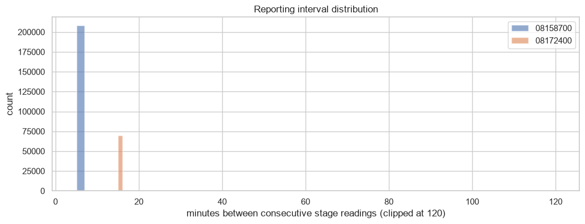

```text
    site_no  median_interval_min  p95_interval_min  max_gap_h  gaps_over_1h  \
0  08158700                  5.0               5.0  67.833333             6   
1  08172400                 15.0              15.0   1.250000             5   

   gaps_over_1d  
0             1  
1             0  
```

**What it says:** DRWT2 reports every 5 min and LCPT2 every 15 min, with almost no other intervals. DRWT2 has one gap longer than a day (68 h), and LCPT2's longest gap is 1.25 h. Windowing must handle both cadences and fill short gaps (the pipeline zero-fills missing windows and flags them).


**Cell 16** · share of expected readings present, per month.

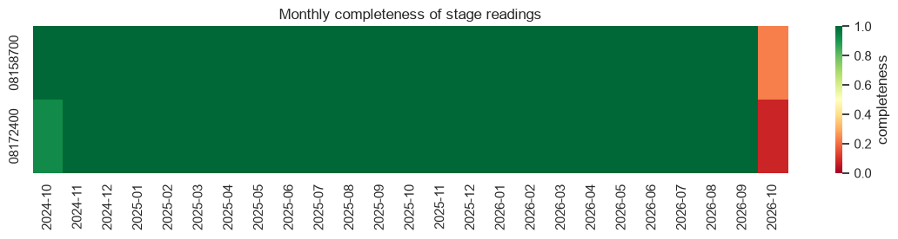

**What it says:** Every month is close to complete. The last month (Oct 2026) is only 3 days in, which is why it is red. The completeness formula assumes 96 readings a day (15-min), so DRWT2's 5-min data is clipped at 1.0: green means "at least full" for that gauge.


#### 4.4 Do the sensor series agree?

**Cell 18** · compares sensor series where a gauge has more than one.

```text
08158700 : single stage series
08172400 : single stage series
```

**What it says:** Each gauge has a single stage sensor, so the backup-sensor check has nothing to compare here. Some gauges elsewhere report a "[PT Backup]" series, and the pipeline keeps it separate.


### 5. Univariate distributions

**Cell 20** · summary statistics.

```text
                           count       mean        std   min    1%   25%  \
site_no  variable                                                          
08158700 discharge_cfs  205337.0   1.168762  10.263929  0.00  0.00  0.00   
         stage_ft       208723.0   1.710091   0.675311  0.41  0.46  0.98   
08172400 discharge_cfs   70071.0  17.697914  49.407813  2.48  3.03  5.36   
         stage_ft        70071.0   2.247958   0.691576  1.70  1.78  1.96   

                         50%    75%      99%      max  
site_no  variable                                      
08158700 discharge_cfs  0.00   0.58   14.364   754.00  
         stage_ft       2.02   2.30    2.630     5.49  
08172400 discharge_cfs  7.11  13.00  178.000  1520.00  
         stage_ft       2.06   2.27    5.100    13.73  
```

**What it says:** Median stage is about 2 ft at both gauges. The maxima, 5.49 ft at DRWT2 and 13.73 ft at LCPT2, are both just below minor flood stage (5.5 and 14 ft): **neither gauge flooded in these two years.** Discharge is near zero most of the time at DRWT2 (median 0 cfs), so Onion Creek is often a series of pools.


**Cell 21** · histograms of stage and log discharge.

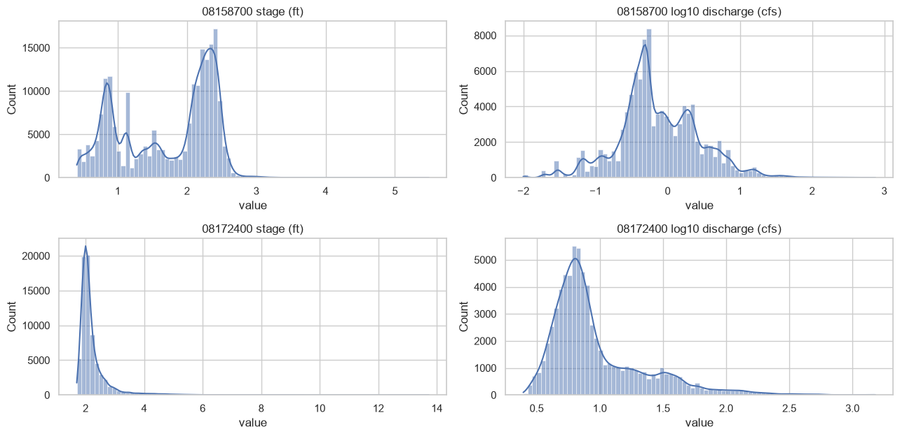

```text
Skewness of stage: {'08158700': np.float64(-0.34), '08172400': np.float64(6.39)}
```

**What it says:** LCPT2's stage is strongly right-skewed (skew 6.4): long quiet periods and rare spikes. DRWT2's stage is two-humped, at about 0.9 ft and 2.3 ft, because its base level drifts with the seasons rather than spiking (next plots). For modelling, stage relative to a recent baseline is more useful than raw stage.


### 6. Time-series behaviour

**Cell 24** · the whole stage record.

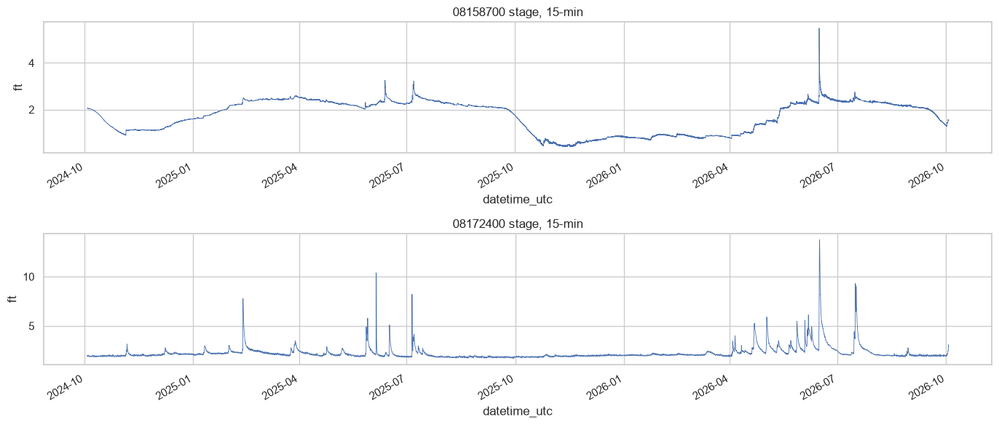

**What it says:** LCPT2 sits at about 2 ft and spikes with each storm, up to 13.7 ft in June 2026. DRWT2 drifts slowly between 0.5 and 2.5 ft over months and spikes rarely. Its sharpest spike, in June 2026, reached 5.49 ft. The two gauges behave very differently even though they are close together.


**Cell 25** · a week around each gauge's highest reading.

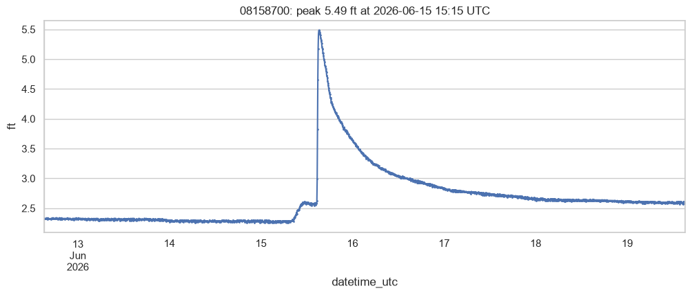

Figure 1: DRWT2: the stage went from 2.6 to 5.5 ft in about 15 minutes (10 ft/h) and then receded over days. From stage alone there is almost no warning at this gauge.

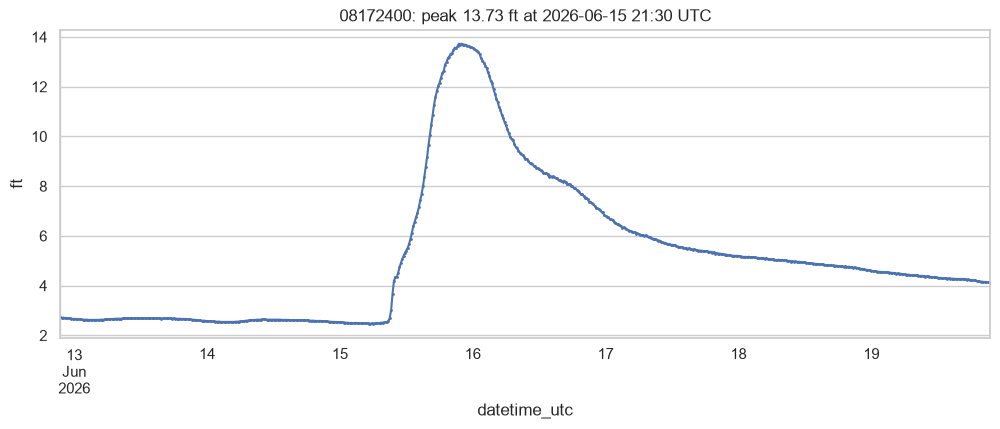

Figure 2: LCPT2: the stage went from 2.5 to 13.7 ft over about 14 hours. This is the kind of rise a forecaster can warn on.

**What it says:** Zoom on each gauge's highest reading. Both peaks came from the same storm on 15 Jun 2026.


### 7. Seasonality and daily cycle

**Cell 27** · stage by month and by hour of day.

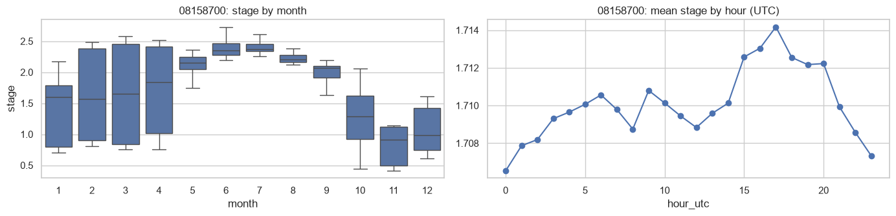

Figure 1: DRWT2: base stage is high from May to September and low from October to April. The daily cycle is under 0.01 ft and can be ignored.

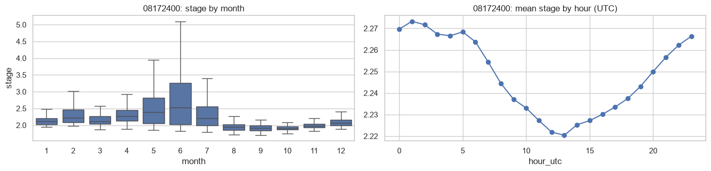

Figure 2: LCPT2: the spread is widest in May–July, when storms hit. Its daily cycle is about 0.05 ft, lowest around 12–13 UTC (early morning in Texas). That is far too small to matter for floods.

**What it says:** Seasonality and daily cycle.


**Cell 28** · daily maximum stage, both gauges.

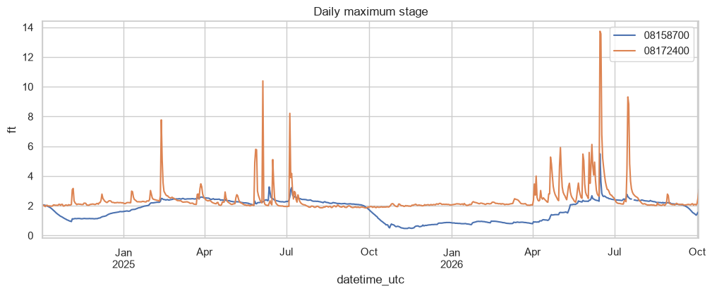

```text
         08158700    08172400
count  729.000000  731.000000
mean     1.735432    2.407086
std      0.693301    1.017909
min      0.470000    1.850000
25%      1.000000    2.040000
50%      2.030000    2.130000
75%      2.320000    2.360000
max      5.490000   13.730000
```

**What it says:** Daily maxima for both gauges on one axis. LCPT2's storm spikes line up with DRWT2's small bumps, so the same storms reach both gauges.


### 8. Relationships

#### 8.1 Stage–discharge (rating curve)

**Cell 30** · stage against discharge (rating curve).

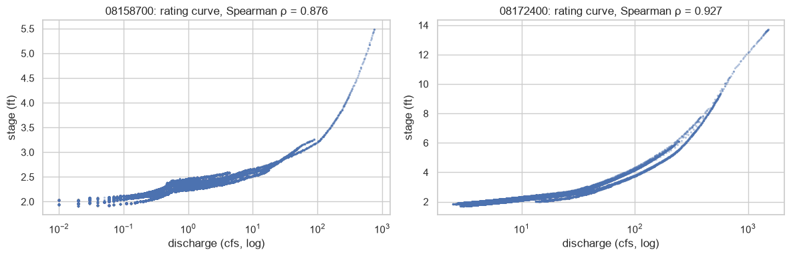

**What it says:** Both gauges have a tight, monotonic stage–discharge relation (Spearman 0.88 and 0.93). The two branches at LCPT2 are most likely a rating shift, where USGS adjusted the curve after the channel changed. Stage and discharge carry the same information, so the pipeline forecasts stage, the variable the official flood categories are defined on.


#### 8.2 Correlation between gauges (hourly stage)

**Cell 32** · correlation between the two gauges.

```text
          08158700  08172400
08158700   1.00000   0.32664
08172400   0.32664   1.00000
```

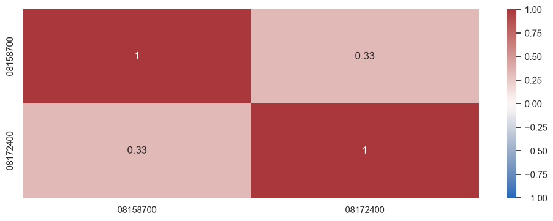

**What it says:** Hourly stage at the two gauges correlates weakly (0.33), because DRWT2's slow drift dominates its record. Each gauge needs its own features. Cross-gauge features would only help for gauges on the same river.


### 9. Temporal dependence (what a forecaster can exploit)

**Cell 34** · autocorrelation, partial autocorrelation and the ADF stationarity test.

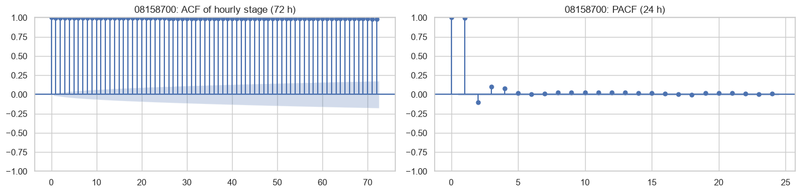

Figure 1: DRWT2: the autocorrelation stays near 1 for 72 h and the ADF test does not reject a unit root (p = 0.68), so the series is not stationary. The partial autocorrelation cuts off after lag 1–2: the last hour or two carry almost all the information.

```text
08158700: ADF statistic -1.19, p = 0.6799 -> not shown stationary
```

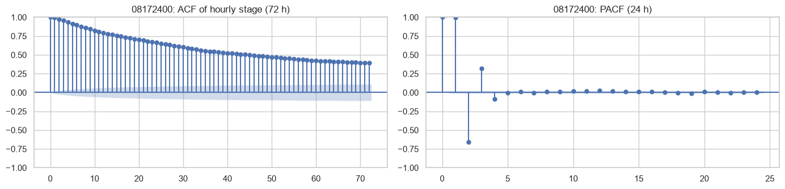

Figure 2: LCPT2: the autocorrelation decays to about 0.4 by 72 h and the ADF test says stationary (p < 0.001). The partial autocorrelation has strong lags 1–3. For forecasting, "same as the last reading" will have low average error at both gauges, but it can never warn of a flood. That is why the evaluation scores warnings, not average error.

```text
08172400: ADF statistic -6.79, p = 0.0000 -> stationary (reject unit root)
```

**What it says:** How strongly each hour depends on the previous ones.


**Cell 35** · 7-day rolling mean and standard deviation.

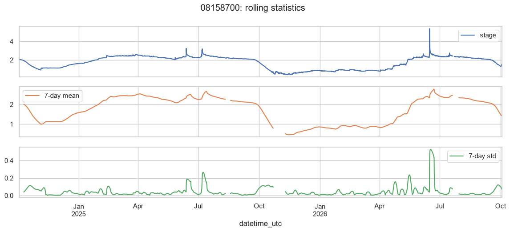

Figure 1: DRWT2: the 7-day mean follows the seasonal drift and the 7-day standard deviation jumps at each event. Gaps in the lines are hours with no readings. A rolling baseline is how the pipeline separates a storm rise from a slow drift.

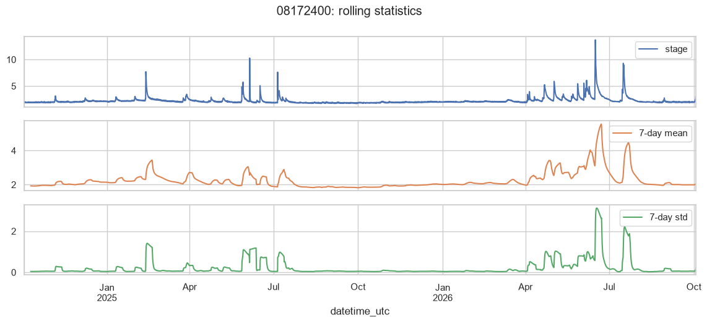

Figure 2: LCPT2: the mean stays near 2 ft and the spread spikes with every storm. Here the rolling spread works as a simple storm detector.

**What it says:** Rolling 7-day mean and spread.


### 10. Outliers and sudden changes

**Cell 37** · outliers and the largest hourly rises.

```text
08158700: 5 largest rises (ft/h)

                           ft_per_h
datetime_utc                       
2026-06-15 14:50:00+00:00     10.08
2026-06-15 14:55:00+00:00      9.84
2026-06-15 15:00:00+00:00      6.36
2026-06-15 14:45:00+00:00      4.44
2026-06-15 15:05:00+00:00      2.88

08172400: 5 largest rises (ft/h)

                           ft_per_h
datetime_utc                       
2025-07-05 14:00:00+00:00      7.32
2025-06-05 04:30:00+00:00      7.24
2025-07-05 13:45:00+00:00      6.56
2025-06-05 04:45:00+00:00      5.52
2025-07-05 14:15:00+00:00      4.20

    site_no  iqr_outliers  rolling_|z|>4  max_rise_ft_per_h  max_fall_ft_per_h
0  08158700             0           1624              10.08              -0.84
1  08172400          3477            169               7.32              -2.00
```

**What it says:** DRWT2's largest rises (up to 10 ft/h) all come from the 15 Jun 2026 storm, and LCPT2's (up to 7.3 ft/h) from June–July 2025. These are real floods, not sensor errors. A fault check must therefore look at sensor behaviour (isolated spikes, flat lines, sensor disagreement), not rise size; this is the rule the Isolation Forest follows. The IQR rule flags 3,477 LCPT2 readings because any storm is an outlier against a 2 ft baseline. That rule is not used.


### 11. Summary

**Cell 40** · one-row summary per gauge.

```text
    site_no  readings        from          to  median_interval_min  \
0  08158700    208723  2024-10-03  2026-10-03                  5.0   
1  08172400     70071  2024-10-03  2026-10-03                 15.0   

   max_stage_ft  median_stage_ft  stage_series  
0          5.49             2.02             1  
1         13.73             2.06             1  
```

**What it says:** Summary: 208,723 readings at DRWT2 (5-min) and 70,071 at LCPT2 (15-min). There is one series per gauge, the median stage is about 2 ft, and neither gauge reached minor flood stage in the two years. Live demos will therefore replay past floods (stamped SIMULATION).


---

# Notebook 02 · Flood-specific EDA (10 years, official flood categories)

Gauges: DRWT2, LCPT2, JNCT2 and AHOT2. Period: 5 Oct 2016 to 3 Oct 2026. Data: USGS stage, NWPS flood
categories, and Open-Meteo hourly rainfall at the gauge point. Purpose: how often floods happen, how fast
rivers rise, how much warning is possible, and how well simple baselines already warn. The event
definitions are the same as the pipeline's gate check, so its numbers match `gate_output/gate_events.csv`.

**Cell 1** · optional install.

**What it says:** No output.


### 1. Setup and configuration

**Cell 3** · helpers (same as notebook 01).

**What it says:** No output. Same helpers as notebook 01.


**Cell 4** · configuration: four gauges, 10 years, minor category, event rules.

**What it says:** No output. `GAUGES` maps USGS site → NWS id; `MIN_GAP_H`, `LOOKBACK_H`, `MIN_EVENTS` and `MIN_RISE_H` are the gate-check rules (24 h, 48 h, 10 events, 3 h).


### 2. Official flood categories (NWPS)

**Cell 6** · official flood categories from the NWPS API.

```text
         action minor moderate major    lid                             name  \
08158700    5.5   5.5      7.0  13.0  DRWT2       Onion Creek near Driftwood   
08172400   12.0  14.0     15.0  19.0  LCPT2           Plum Creek at Lockhart   
08150000   12.0  16.0     22.0  31.0  JNCT2        Llano River near Junction   
08156800    5.0   7.0     10.0  12.0  AHOT2  Shoal Creek at West 12th Street   

           usgs_id units  
08158700  08158700    ft  
08172400  08172400    ft  
08150000  08150000    ft  
08156800  08156800    ft  
```

**What it says:** Official categories from NOAA. At DRWT2 the action and minor stages are the same (5.5 ft). LCPT2 has no recorded major flood in the period (major = 19 ft). These are the only thresholds the alerts use; none is invented.


### 3. Stage history

**Cell 8** · 10 years of stage, downloaded in 180-day chunks.

```text
  2016-10-05 .. 2017-04-03: 173,296 readings
  2017-04-04 .. 2017-10-01: 172,106 readings
  2017-10-02 .. 2018-03-31: 172,046 readings
  2018-04-01 .. 2018-09-28: 173,215 readings
  2018-09-29 .. 2019-03-28: 173,610 readings
  2019-03-29 .. 2019-09-25: 173,198 readings
  2019-09-26 .. 2020-03-24: 173,319 readings
  2020-03-25 .. 2020-09-21: 173,697 readings
  2020-09-22 .. 2021-03-21: 172,769 readings
  2021-03-22 .. 2021-09-18: 173,710 readings
  2021-09-19 .. 2022-03-18: 171,768 readings
  2022-03-19 .. 2022-09-15: 173,659 readings
  2022-09-16 .. 2023-03-15: 173,700 readings
  2023-03-16 .. 2023-09-12: 173,681 readings
  2023-09-13 .. 2024-03-11: 156,879 readings
  2024-03-12 .. 2024-09-08: 173,699 readings
  2024-09-09 .. 2025-03-08: 173,677 readings
  2025-03-09 .. 2025-09-05: 173,400 readings
  2025-09-06 .. 2026-03-05: 163,952 readings
  2026-03-06 .. 2026-09-02: 179,166 readings
  2026-09-03 .. 2026-10-03: 28,427 readings

         readings                       from                         to
08158700  1030301  2016-10-05 05:00:00+00:00  2026-10-03 06:30:00+00:00
08172400   349919  2016-10-05 05:00:00+00:00  2026-10-03 07:00:00+00:00
08150000  1049775  2016-10-05 05:00:00+00:00  2026-10-03 06:30:00+00:00
08156800  1026858  2016-10-05 05:00:00+00:00  2026-10-03 06:15:00+00:00
```

**What it says:** About 3.46 million readings for the four gauges in 10 years: about 1 million each for the 5-min gauges and 350,000 for LCPT2.


### 4. How often is each flood category reached?

**Cell 10** · share of time at or above each category.

```text
     site_no  category  stage_ft  % of readings at/above  \
0   08158700    action       5.5                   0.211   
1   08158700     minor       5.5                   0.211   
2   08158700  moderate       7.0                   0.049   
3   08158700     major      13.0                   0.013   
4   08172400    action      12.0                   0.499   
5   08172400     minor      14.0                   0.272   
6   08172400  moderate      15.0                   0.184   
7   08172400     major      19.0                   0.000   
8   08150000    action      12.0                   0.161   
9   08150000     minor      16.0                   0.098   
10  08150000  moderate      22.0                   0.034   
11  08150000     major      31.0                   0.002   
12  08156800    action       5.0                   0.177   
13  08156800     minor       7.0                   0.055   
14  08156800  moderate      10.0                   0.016   
15  08156800     major      12.0                   0.005   

    days with any reading at/above  
0                               22  
1                               22  
2                                8  
3                                3  
4                               39  
5                               23  
6                               15  
7                                0  
8                               16  
... (7 more lines in the notebook)
```

**What it says:** Each gauge is at or above minor flood stage for only 0.05–0.27 % of its readings, on 13–39 days in 10 years. Floods are a rare class, so accuracy would look excellent for a model that never warns. Scores are event-based instead (precision, recall, F1, false-alarm rate, lead time).


**Cell 11** · stage-duration curves with the categories drawn in.

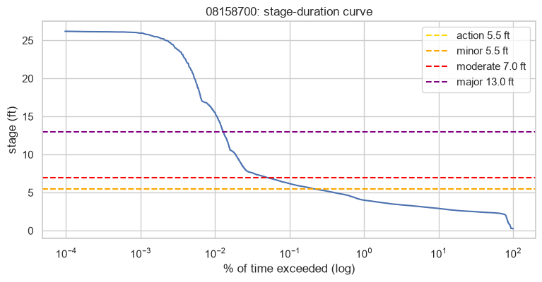

Figure 1: DRWT2: minor stage (5.5 ft) is exceeded about 0.2 % of the time. Above about 7 ft the curve turns almost vertical, so big floods are much rarer still.

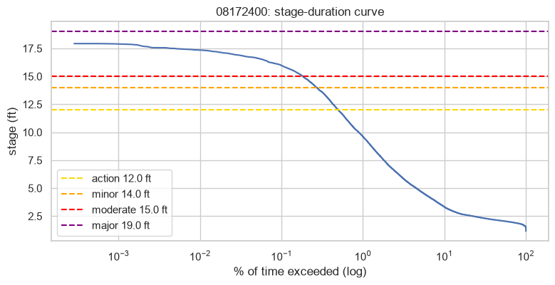

Figure 2: LCPT2: minor (14 ft) about 0.27 % of the time. Major (19 ft) is above the highest reading in 10 years.

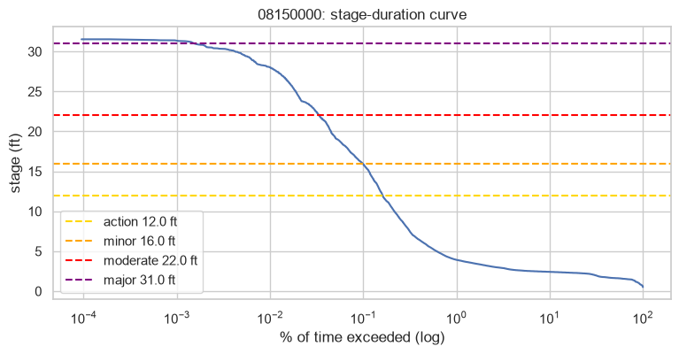

Figure 3: JNCT2 (Llano River near Junction): minor (16 ft) about 0.1 % of the time. The river reached major (31 ft) once.

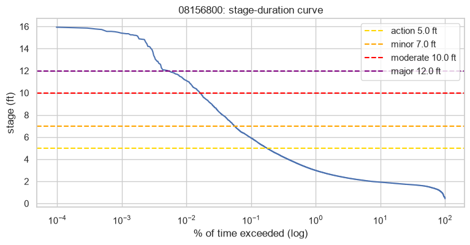

Figure 4: AHOT2 (Shoal Creek, Austin): minor (7 ft) about 0.05 % of the time, the smallest share of the four, although it has the most events. Each flood lasts about an hour.

**What it says:** Stage-duration curves: the share of time (log scale) the stage is at or above each level, with the official categories drawn in. The flood lines sit in the top 0.01–0.3 % of time at every gauge.


### 5. Flood events

**Cell 13** · flood event detection (same rules as the gate check).

```text
08158700: 16 events at/above minor (5.5 ft)
08172400: 15 events at/above minor (14.0 ft)
08150000: 9 events at/above minor (16.0 ft)
08156800: 38 events at/above minor (7.0 ft)

                    crossing                rise_start  rise_start_ft  \
0  2017-01-18 17:25:00+00:00 2017-01-18 16:10:00+00:00           5.02   
1  2017-02-20 11:40:00+00:00 2017-02-19 18:45:00+00:00           2.97   
2  2017-03-10 01:55:00+00:00 2017-03-09 15:55:00+00:00           3.20   
3  2017-04-11 21:25:00+00:00 2017-04-11 07:20:00+00:00           2.90   
4  2017-06-10 05:45:00+00:00 2017-06-10 01:50:00+00:00           2.46   
5  2018-09-22 12:20:00+00:00 2018-09-20 18:55:00+00:00           2.53   
6  2018-10-16 11:55:00+00:00 2018-10-16 09:30:00+00:00           4.77   
7  2018-12-27 07:50:00+00:00 2018-12-26 12:15:00+00:00           2.94   
8  2019-01-02 22:35:00+00:00 2019-01-02 10:45:00+00:00           3.76   
9  2019-05-04 01:40:00+00:00 2019-05-03 07:25:00+00:00           2.80   
10 2019-05-08 05:00:00+00:00 2019-05-07 22:30:00+00:00           4.35   
11 2020-05-25 03:00:00+00:00 2020-05-25 01:10:00+00:00           2.36   
12 2021-06-03 20:15:00+00:00 2021-06-03 03:00:00+00:00           2.68   
13 2021-06-05 09:45:00+00:00 2021-06-05 08:50:00+00:00           3.44   
14 2021-10-14 04:55:00+00:00 2021-10-13 20:15:00+00:00           2.42   
15 2024-06-01 06:40:00+00:00 2024-05-31 10:20:00+00:00           2.38   
16 2017-01-19 02:30:00+00:00 2017-01-17 21:15:00+00:00           4.17   
17 2017-08-27 03:45:00+00:00 2017-08-26 19:45:00+00:00           2.86   
18 2018-03-28 18:30:00+00:00 2018-03-27 21:15:00+00:00           1.79   
19 2018-12-07 23:00:00+00:00 2018-12-07 22:30:00+00:00          13.79   

    rise_time_h                 peak_time  peak_ft  time_to_peak_h  \
0      1.250000 2017-01-18 18:25:00+00:00     6.38        1.000000   
1     16.916667 2017-02-20 13:50:00+00:00     6.41        2.166667   
2     10.000000 2017-03-10 02:10:00+00:00     5.66        0.250000   
3     14.083333 2017-04-11 22:00:00+00:00     6.75        0.583333   
4      3.916667 2017-06-10 05:50:00+00:00     5.86        0.083333   
... (37 more lines in the notebook)
```

**What it says:** 16, 15, 9 and 38 events, identical to the gate check, so the notebook and the pipeline use the same definitions. Each row gives the crossing, the rise start, the peak, the time to peak and the hours above minor stage. For example, DRWT2's 4 May 2019 flood rose for 18 h from 2.8 ft and peaked at 26.2 ft.


**Cell 14** · events per year, per month, and peak heights.

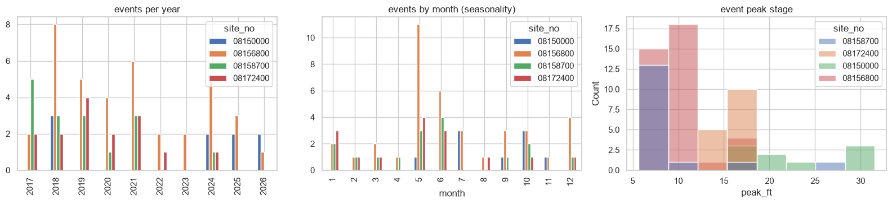

**What it says:** Left: AHOT2 floods almost every year; the slow gauges flood in clusters (2017–2019, 2021). There were few floods in 2022–2023 at these four gauges. Middle: May dominates, with smaller peaks in June and October. Right: most floods peak just above minor stage; a few reach 25–30 ft (DRWT2, JNCT2). A time-based train/test split must keep flood years on both sides.


### 6. Rise time — how much warning does the river itself give?

**Cell 16** · rise-time distribution and per-gauge statistics.

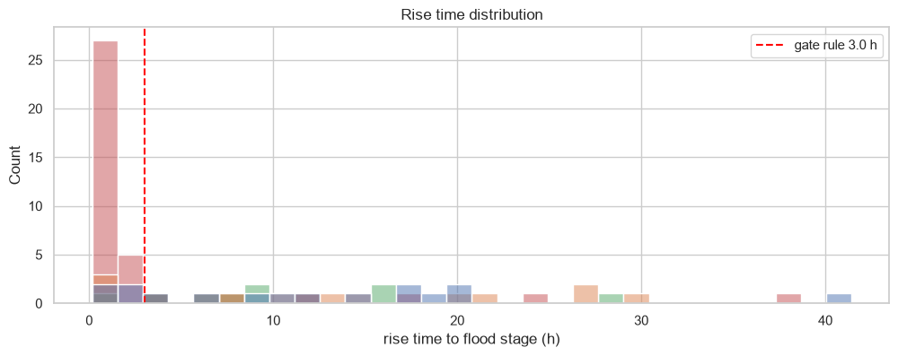

```text
site_no               08150000  08156800  08158700  08172400
rise_time_h    count      9.00     38.00     16.00     15.00
               mean      10.88      3.40     12.20     12.97
               std        7.98      7.55     10.43     10.05
               min        1.33      0.17      0.92      0.25
               25%        6.00      0.35      3.54      4.88
               50%        9.50      0.88     10.92     11.75
               75%       15.58      1.81     17.50     20.75
               max       27.75     37.58     41.42     29.25
time_to_peak_h count      9.00     38.00     16.00     15.00
               mean       5.53      2.08      2.70      5.72
               std       10.42      7.82      4.33      4.54
               min        0.17      0.00      0.08      1.25
               25%        1.17      0.19      0.54      2.88
               50%        1.92      0.42      1.33      5.00
               75%        3.75      0.67      3.04      6.75
               max       33.08     45.83     18.00     19.25
hours_above    count      9.00     38.00     16.00     15.00
               mean       5.67      1.08      8.21     14.47
               std        3.96      0.58      8.31     12.46
               min        0.42      0.17      0.75      0.25
               25%        2.92      0.58      2.98      5.50
               50%        4.92      1.04      6.21     14.00
               75%        8.50      1.56      9.35     18.88
               max       12.50      2.25     30.33     47.00
```

**What it says:** AHOT2's rise times are almost all under 2 h (median 0.9 h). The three rivers spread from about 1 to 41 h (medians 9.5–11.8 h). Note that rise time counts from the nearest trough, and at DRWT2 the stage often creeps for hours and then jumps in the last hour. So rise time overstates the warning that stage alone gives (next plot). The table also gives time to peak and hours above minor: LCPT2 floods last longest (median 14 h above minor).


**Cell 17** · every event aligned at its crossing.

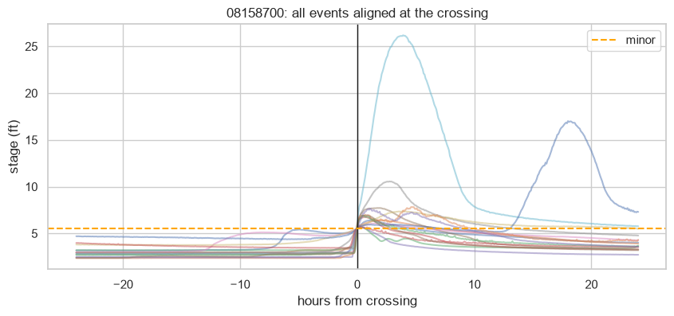

Figure 1: DRWT2: flat at 2.5–5 ft until roughly the last hour, then a near-vertical jump. The big outlier is 4 May 2019 (26 ft); a second storm made a second peak 18 h later. **Stage alone gives about an hour here; rainfall must supply the rest.**

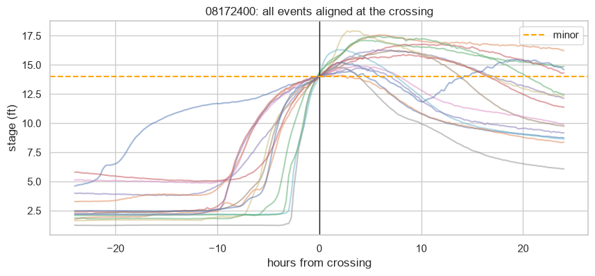

Figure 2: LCPT2: most floods climb steadily for 3–8 h before crossing 14 ft, and one climbed for about 20 h. This is the gauge where a stage-based forecast has the most room.

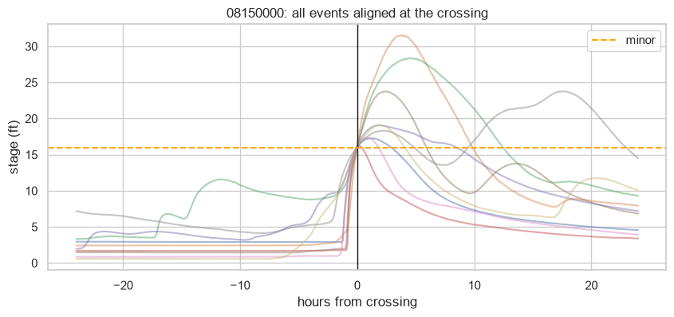

Figure 3: JNCT2: some floods climb over the last 3–5 h, others jump in the last hour, but peaks reach 30 ft and stay above minor for hours.

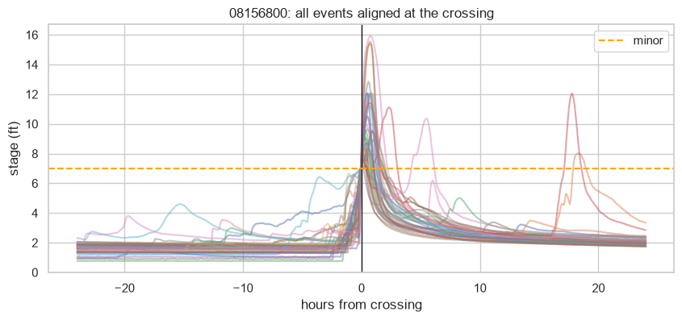

Figure 4: AHOT2: every one of the 38 floods jumps in under an hour and recedes within about 2 h. This is a flash-flood response: with a ~1 h feed delay, no stage-based warning is possible.

**What it says:** Every flood at one gauge drawn on one axis, with t = 0 at the moment it crossed minor flood stage. The slope before t = 0 shows how much warning the river itself gives.


### 7. Rise rates — normal behaviour vs. the hours before a flood

**Cell 19** · hourly rise rate, normal hours vs the 6 h before a crossing.

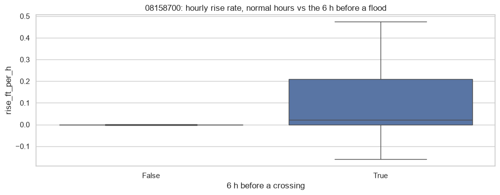

Figure 1: DRWT2: normal hours have a median of 0.0 ft/h; the 6 h before a flood a median of 0.02 ft/h (mean 0.3). The signal is weak because most of the rise happens in the last hour.

```text
                         count   mean    std    min    25%    50%    75%  \
6 h before a crossing                                                      
False                  86024.0 -0.000  0.063 -4.058 -0.002  0.000  0.000   
True                      96.0  0.301  0.678 -0.160  0.000  0.022  0.211   

                         max  
6 h before a crossing         
False                  7.912  
True                   3.748  
```

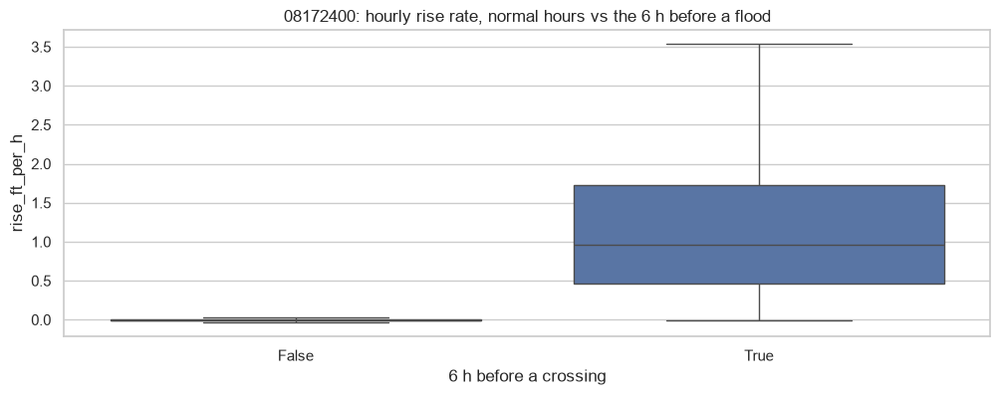

Figure 2: LCPT2: normal 0.0 ft/h vs a median of 0.96 ft/h before a flood. A clear separation: rise rate is a strong feature here.

```text
                         count   mean    std    min    25%    50%    75%  \
6 h before a crossing                                                      
False                  87422.0 -0.001  0.090 -1.740 -0.012 -0.005  0.005   
True                      90.0  1.307  1.224 -0.008  0.461  0.959  1.730   

                         max  
6 h before a crossing         
False                  4.462  
True                   6.047  
```

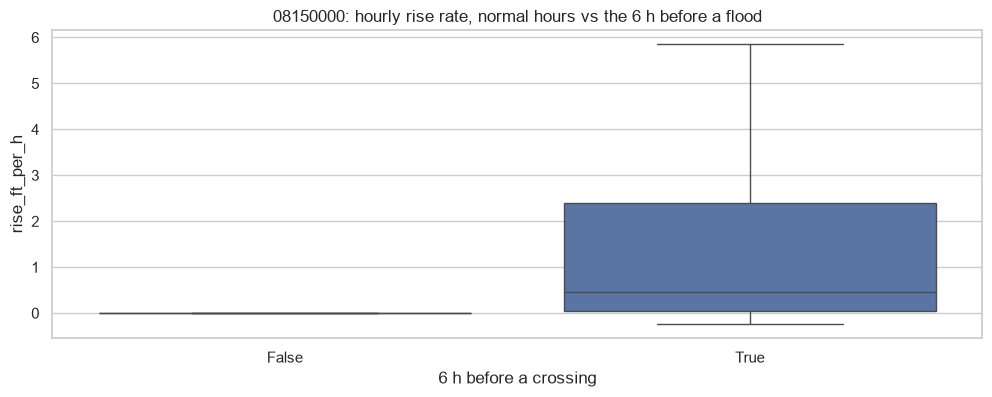

Figure 3: JNCT2: median 0.46 ft/h before a flood (mean 2.0, max 12.2). The signal is there, but it arrives late.

```text
                         count   mean    std    min    25%    50%    75%  \
6 h before a crossing                                                      
False                  87545.0 -0.001  0.093 -3.381 -0.002  0.000  0.001   
True                      54.0  2.020  3.262 -0.243  0.042  0.461  2.404   

                          max  
6 h before a crossing          
False                   6.192  
True                   12.210  
```

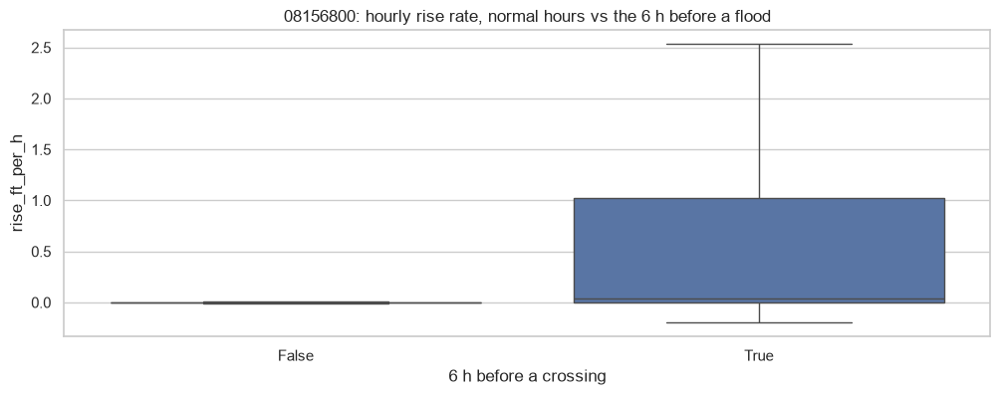

Figure 4: AHOT2: median 0.04 ft/h before a flood. The rise comes too fast to show up in hourly averages.

```text
                         count   mean    std    min    25%    50%    75%  \
6 h before a crossing                                                      
False                  85691.0 -0.002  0.134 -7.789 -0.005 -0.001  0.000   
True                     228.0  0.845  1.512 -0.198 -0.003  0.039  1.022   

                         max  
6 h before a crossing         
False                  8.371  
True                   6.886  
```

**What it says:** The hourly change in stage, compared between ordinary hours and the 6 hours before a crossing. It shows whether the rise rate separates "a flood is coming" from normal behaviour.


### 8. Live feed delay (how old is the newest reading when we fetch it?)

**Cell 21** · one live fetch: how old the newest reading is.

```text
    site_no  series                    newest  readings_6h  provisional_share  \
0  08150000  141212 2026-10-03 06:30:00+00:00           62                1.0   
1  08156800  141287 2026-10-03 06:15:00+00:00           59                1.0   
2  08156800  224497 2026-10-03 05:20:00+00:00           48                1.0   
3  08158700  141337 2026-10-03 06:30:00+00:00           62                1.0   
4  08172400  141617 2026-10-03 07:00:00+00:00           23                1.0   

   delay_min  
0       54.2  
1       69.2  
2      124.2  
3       54.2  
4       24.2  
```

**What it says:** One live fetch at about 07:25 UTC: the newest readings were 24–69 min old (124 min for AHOT2's second series). The USGS feed transmits roughly hourly, so this delay is built into any real-time system on these data. The 48 h `staleness_logger` run measures its distribution.


**Cell 23** · usable warning = median rise time − live delay.

```text
          median_rise_h  live_delay_h  usable_warning_h
site_no                                                
08150000           9.50          0.90              8.60
08156800           0.88          1.15             -0.28
08158700          10.92          0.90             10.01
08172400          11.75          0.40             11.35
```

**What it says:** Usable warning = median rise time − live delay: about 10 h at DRWT2, 11.4 h at LCPT2 and 8.6 h at JNCT2, and below zero at AHOT2. Read this as an upper bound: rise time overstates the stage-only warning at DRWT2 and JNCT2 (cell 17).


### 9. Rain → stage response (Open-Meteo hourly rainfall at the gauge)

**Cell 25** · hourly rainfall vs stage around the five biggest floods per gauge.

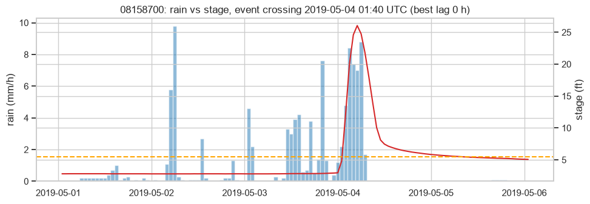

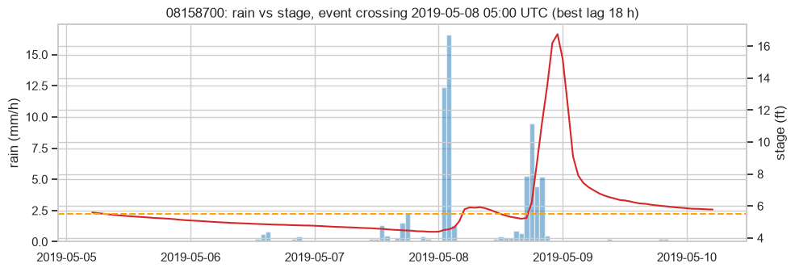

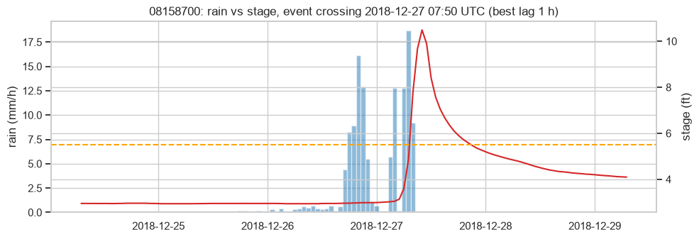

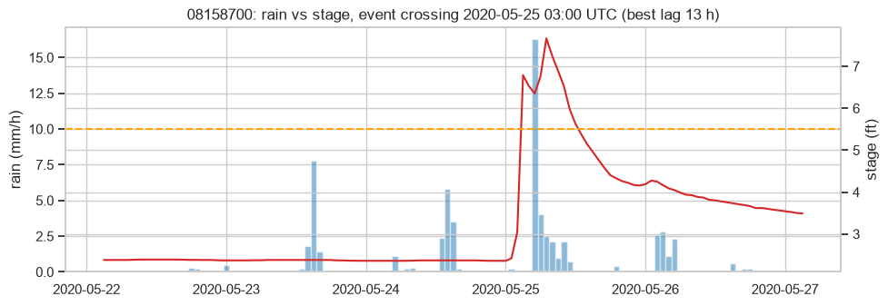

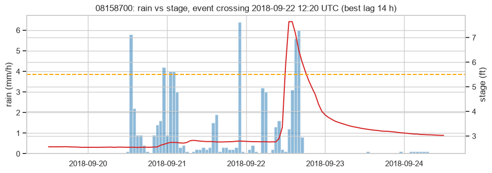

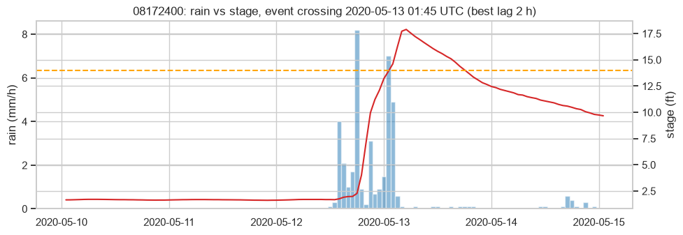

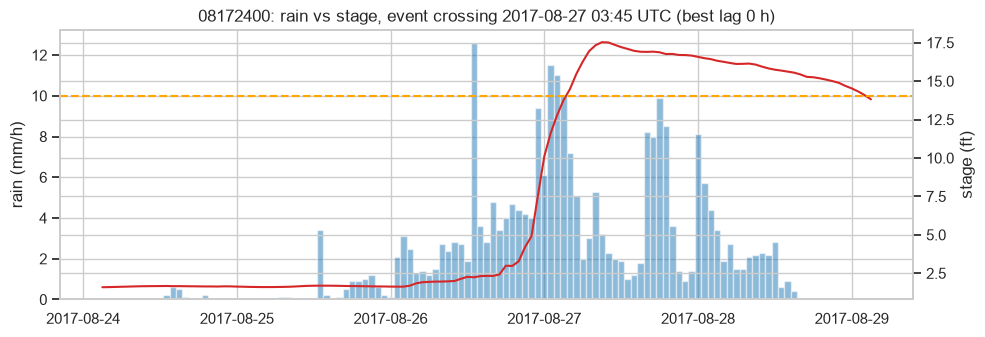

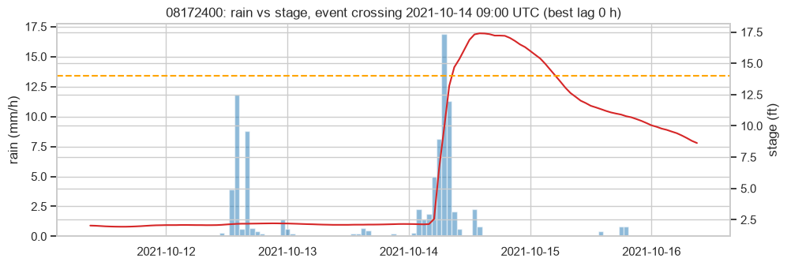

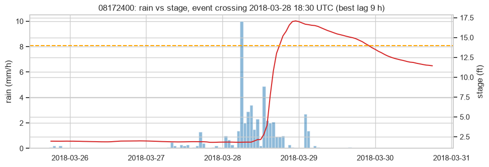

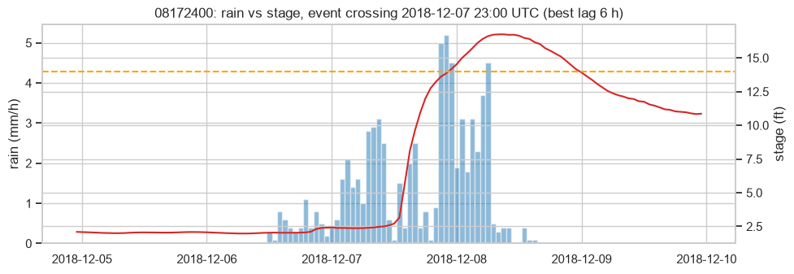

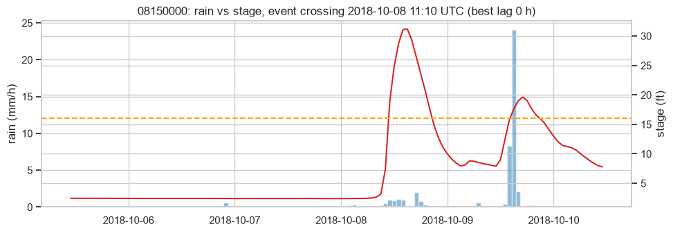

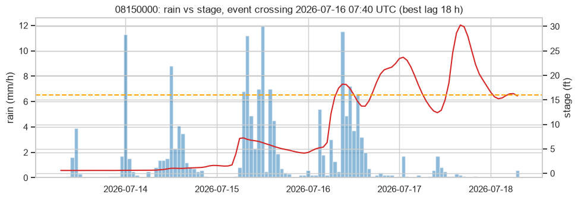

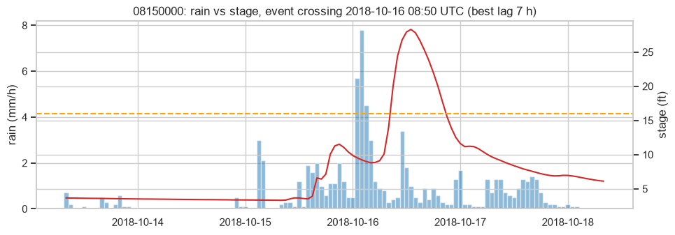

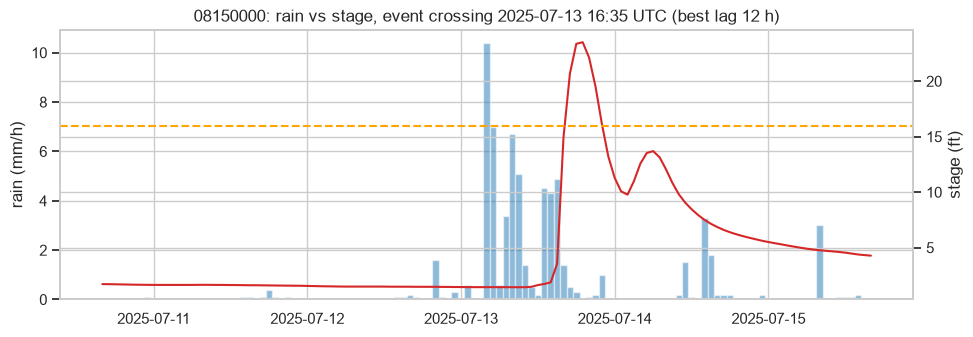

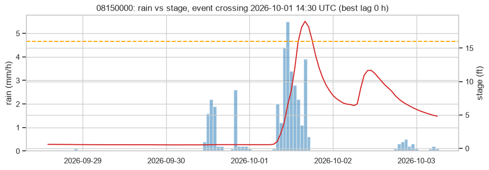

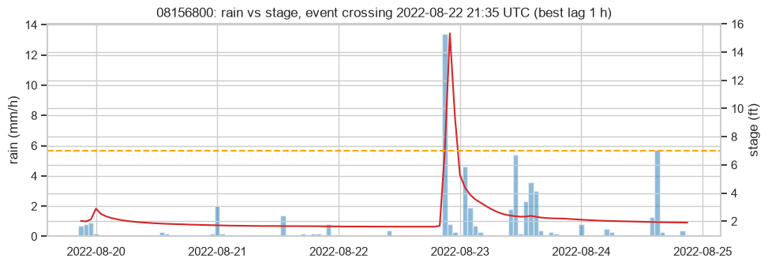

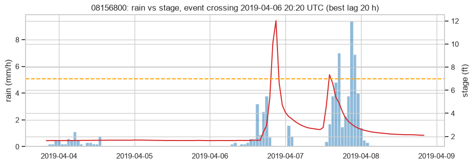

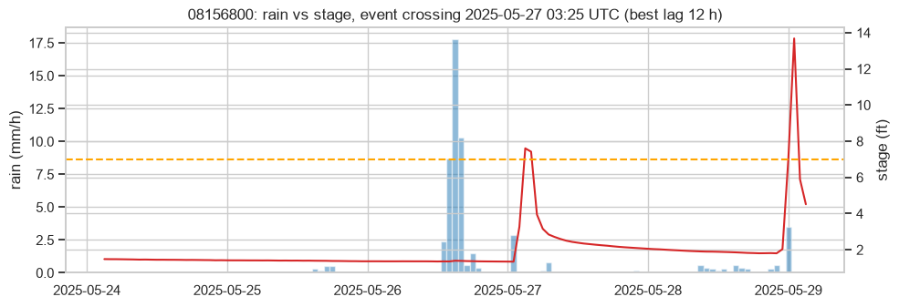

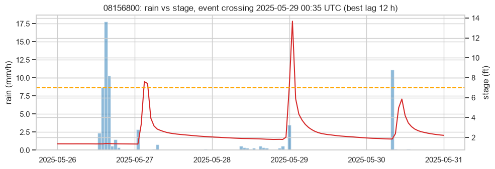

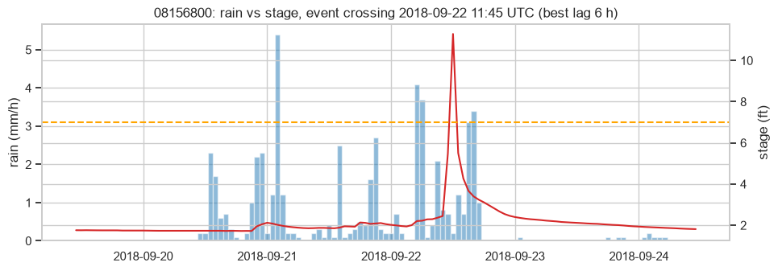

```text
     site_no                  crossing  rain_mm_total  best_lag_h  corr_at_lag
0   08158700 2019-05-04 01:40:00+00:00          106.7           0         0.42
1   08158700 2019-05-08 05:00:00+00:00           70.1          18         0.44
2   08158700 2018-12-27 07:50:00+00:00          124.8           1         0.57
3   08158700 2020-05-25 03:00:00+00:00           67.1          13         0.22
4   08158700 2018-09-22 12:20:00+00:00           71.6          14         0.25
5   08172400 2020-05-13 01:45:00+00:00           39.9           2         0.72
6   08172400 2017-08-27 03:45:00+00:00          253.6           0         0.53
7   08172400 2021-10-14 09:00:00+00:00           87.5           0         0.72
8   08172400 2018-03-28 18:30:00+00:00           49.3           9         0.74
9   08172400 2018-12-07 23:00:00+00:00           72.5           6         0.44
10  08150000 2018-10-08 11:10:00+00:00           46.6           0         0.20
11  08150000 2026-07-16 07:40:00+00:00          172.0          18         0.13
12  08150000 2018-10-16 08:50:00+00:00           78.1           7         0.57
13  08150000 2025-07-13 16:35:00+00:00           67.8          12         0.52
14  08150000 2026-10-01 14:30:00+00:00           39.5           0         0.58
15  08156800 2022-08-22 21:35:00+00:00           58.7           1         0.50
16  08156800 2019-04-06 20:20:00+00:00           70.8          20         0.09
17  08156800 2025-05-27 03:25:00+00:00           56.1          12         0.31
18  08156800 2025-05-29 00:35:00+00:00           66.1          12         0.27
19  08156800 2018-09-22 11:45:00+00:00           53.8           6         0.33
```

**What it says:** Hourly rainfall at the gauge point (Open-Meteo reanalysis, bars) against stage (red line), around the five largest floods at each gauge. The dashed line is minor flood stage. The table gives total rain and the lag at which rain and stage correlate best. Lags range from 0 to 20 h and correlations from 0.09 to 0.74. Some floods rise with almost no rain at the gauge point, e.g. JNCT2 on 8 Oct 2018, which reached 31 ft: the rain fell upstream. **So the pipeline needs rainfall over the whole upstream catchment (MRMS grid cells), not at the gauge, and several accumulation windows (1, 3, 6, 24 h) rather than one fixed lag.**


### 10. How well do simple baselines already warn?

**Cell 27** · persistence and rise-rate baselines scored as warnings.

```text
     site_no        model  horizon_h  alerts  false_alarms  events  detected  \
0   08158700  persistence          1       0             0      16         0   
1   08158700    rise_rate          1      13             5      16         8   
2   08158700  persistence          2       0             0      16         0   
3   08158700    rise_rate          2      20             9      16        11   
4   08158700  persistence          3       0             0      16         0   
5   08158700    rise_rate          3      21             9      16        12   
6   08158700  persistence          6       0             0      16         0   
7   08158700    rise_rate          6      34            20      16        14   
8   08172400  persistence          1       0             0      15         0   
9   08172400    rise_rate          1      16            13      15         3   
10  08172400  persistence          2       0             0      15         0   
11  08172400    rise_rate          2      24            21      15         3   
12  08172400  persistence          3       0             0      15         0   
13  08172400    rise_rate          3      38            31      15         7   
14  08172400  persistence          6       0             0      15         0   
15  08172400    rise_rate          6      58            43      15        15   
16  08150000  persistence          1       0             0       9         0   
17  08150000    rise_rate          1      11             5       9         6   
18  08150000  persistence          2       0             0       9         0   
19  08150000    rise_rate          2      14             6       9         8   
20  08150000  persistence          3       0             0       9         0   
21  08150000    rise_rate          3      19            10       9         9   
22  08150000  persistence          6       0             0       9         0   
23  08150000    rise_rate          6      23            14       9         9   
24  08156800  persistence          1       0             0      38         0   
25  08156800    rise_rate          1      46            31      38        15   
26  08156800  persistence          2       0             0      38         0   
... (39 more lines in the notebook)
```

**What it says:** Baselines scored as warnings at 1, 2, 3 and 6 h horizons. Persistence predicts no change, so it never warns before a crossing (recall 0). Rise-rate extrapolation (current stage + recent rise × horizon) is the simplest model that can warn. At 3 h it reaches F1 0.65 at DRWT2, 0.26 at LCPT2, 0.64 at JNCT2 and 0.41 at AHOT2, but the median warning is under 1 h at three gauges and 2 h at LCPT2. Longer horizons catch more floods at the cost of many more false alarms (AHOT2 at 6 h: 165 false alarms for 35 detections). This is the bar the supervised forecaster must beat: more lead time with fewer false alarms.


### 11. Gate summary for each gauge

**Cell 30** · per-gauge PASS/FAIL against the gate rules.

```text
    site_no    lid  events  median_rise_h verdict                     reason
0  08158700  DRWT2      16      10.916667    PASS                           
1  08172400  LCPT2      15      11.750000    PASS                           
2  08150000  JNCT2       9       9.500000    FAIL              only 9 events
3  08156800  AHOT2      38       0.875000    FAIL  median rise 0.9 h < 3.0 h
```

**What it says:** DRWT2 and LCPT2 pass (at least 10 events, median rise of at least 3 h). JNCT2 fails on count (9) and AHOT2 on speed (0.9 h). Across all 38 candidate gauges, the gate check found 123 slow floods, which is why evaluation pools events across gauges.


---

# Notebook 03 · MRMS radar rainfall (feed and grid)

Data: NOAA MRMS on the AWS public bucket. Purpose: which rainfall product to stream, how often it is
published, how late each file arrives, and what one decoded grid looks like. The optional event section
(rainfall maps around one flood) was removed; notebook 02's rain-vs-stage plots cover that question.

**Cell 1** · installs cfgrib, eccodes, xarray.

**What it says:** Setup only.


### 1. Setup and configuration

**Cell 3** · helpers.

**What it says:** No output. Anonymous S3 listing over HTTPS and file download helpers.


**Cell 4** · configuration: bucket, product, gauge and event.

**What it says:** No output. Product `MultiSensor_QPE_01H_Pass2_00.00` (hourly, gauge-corrected) and gauge DRWT2.


### 2. What is in the bucket?

**Cell 6** · lists the MRMS products in the bucket.

```text
243 CONUS products; 34 rainfall (QPE) products, e.g.:
   CONUS/FLASH_QPE_ARI01H_00.00/
   CONUS/FLASH_QPE_ARI03H_00.00/
   CONUS/FLASH_QPE_ARI06H_00.00/
   CONUS/FLASH_QPE_ARI12H_00.00/
   CONUS/FLASH_QPE_ARI24H_00.00/
   CONUS/FLASH_QPE_ARI30M_00.00/
   CONUS/FLASH_QPE_ARIMAX_00.00/
   CONUS/FLASH_QPE_FFG01H_00.00/
   CONUS/FLASH_QPE_FFG03H_00.00/
   CONUS/FLASH_QPE_FFG06H_00.00/
   CONUS/FLASH_QPE_FFGMAX_00.00/
   CONUS/MultiSensor_QPE_01H_Pass1_00.00/
   CONUS/MultiSensor_QPE_01H_Pass2_00.00/
   CONUS/MultiSensor_QPE_03H_Pass1_00.00/
   CONUS/MultiSensor_QPE_03H_Pass2_00.00/
   CONUS/MultiSensor_QPE_06H_Pass1_00.00/
   CONUS/MultiSensor_QPE_06H_Pass2_00.00/
   CONUS/MultiSensor_QPE_12H_Pass1_00.00/
   CONUS/MultiSensor_QPE_12H_Pass2_00.00/
   CONUS/MultiSensor_QPE_24H_Pass1_00.00/
   CONUS/MultiSensor_QPE_24H_Pass2_00.00/
   CONUS/MultiSensor_QPE_48H_Pass1_00.00/
   CONUS/MultiSensor_QPE_48H_Pass2_00.00/
   CONUS/MultiSensor_QPE_72H_Pass1_00.00/
   CONUS/MultiSensor_QPE_72H_Pass2_00.00/
```

**What it says:** The bucket holds 243 CONUS products, 34 of them rainfall (QPE). MultiSensor QPE combines radar with rain gauges; Pass 1 is fast, and Pass 2 waits for more gauge reports and is more accurate. FLASH products compare rain with flash-flood guidance and are a possible extra feature later.


**Cell 7** · lists one day's files for the chosen product.

```text
MultiSensor_QPE_01H_Pass2_00.00 on 2026-10-02: 24 files, size 720,692–956,280 bytes

                                                 key    size  \
0  CONUS/MultiSensor_QPE_01H_Pass2_00.00/20261002...  956280   
1  CONUS/MultiSensor_QPE_01H_Pass2_00.00/20261002...  905052   
2  CONUS/MultiSensor_QPE_01H_Pass2_00.00/20261002...  878859   
3  CONUS/MultiSensor_QPE_01H_Pass2_00.00/20261002...  841145   
4  CONUS/MultiSensor_QPE_01H_Pass2_00.00/20261002...  836901   

              last_modified                valid_time  
0 2026-10-02 00:58:15+00:00 2026-10-02 00:00:00+00:00  
1 2026-10-02 01:58:18+00:00 2026-10-02 01:00:00+00:00  
2 2026-10-02 02:58:24+00:00 2026-10-02 02:00:00+00:00  
3 2026-10-02 03:58:19+00:00 2026-10-02 03:00:00+00:00  
4 2026-10-02 04:57:34+00:00 2026-10-02 04:00:00+00:00  
```

**What it says:** 24 hourly files per day for the chosen product, each about 0.7–1.0 MB compressed. The full CONUS grid every hour is a small stream for Kafka.


### 3. Publication delay (how long after the hour does the file appear?)

**Cell 9** · publication delay: upload time minus valid time.

```text
count    24.0
mean     58.4
std       0.4
min      57.6
25%      58.2
50%      58.3
75%      58.5
max      59.6
Name: delay_min, dtype: float64
```

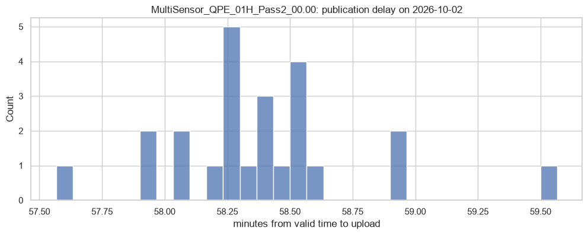

```text
Note: archive files re-uploaded later have meaningless LastModified; use recent days for this check.
```

**What it says:** Each hourly Pass 2 file appears 57.6–59.6 min after its valid hour (median 58.3 min). Using this product live would add about an hour to every alert. Only recent days give a true delay, because archived files may have been re-uploaded later.


**Cell 10** · cadence and delay of four rainfall products.

```text
                           product  files_per_day  cadence_min  \
0  MultiSensor_QPE_01H_Pass1_00.00             24         60.0   
1  MultiSensor_QPE_01H_Pass2_00.00             24         60.0   
2          RadarOnly_QPE_01H_00.00            716          2.0   
3          RadarOnly_QPE_15M_00.00             96         15.0   

   median_delay_min  median_size_kb  
0              16.1           829.9  
1              58.3           818.5  
2               2.9           924.3  
3               4.5           563.6  
```

**What it says:** Pass 1 hourly arrives in about 16 min, the radar-only 1-hour accumulation is refreshed every 2 min with a 2.9 min delay, and the radar-only 15-min product arrives in 4.5 min. **Decision: the live rainfall producer uses the radar-only or Pass 1 products; evaluation uses Pass 2 for accuracy.** The latency budget records which one was used.


### 4. Decode one hourly grid

**Cell 12** · downloads and decodes one hourly grid.

```text
CONUS/MultiSensor_QPE_01H_Pass2_00.00/20261002/MRMS_MultiSensor_QPE_01H_Pass2_00.00_20261002-120000.grib2.gz
<xarray.DataArray 'unknown' (latitude: 3500, longitude: 7000)> Size: 98MB
[24500000 values with dtype=float32]
Coordinates:
  * latitude        (latitude) float64 28kB 54.99 54.98 54.98 ... 20.02 20.01
  * longitude       (longitude) float64 56kB -130.0 -130.0 ... -60.02 -60.01
    time            datetime64[ns] 8B ...
    step            timedelta64[ns] 8B ...
    heightAboveSea  float64 8B ...
    valid_time      datetime64[ns] 8B ...
Attributes: (12/30)
    GRIB_paramId:                             0
    GRIB_dataType:                            ra
    GRIB_numberOfPoints:                      24500000
    GRIB_typeOfLevel:                         heightAboveSea
    GRIB_stepUnits:                           1
    GRIB_stepType:                            instant
    ...                                       ...
    GRIB_name:                                unknown
    GRIB_shortName:                           unknown
    GRIB_units:                               unknown
    long_name:                                unknown
    units:                                    unknown
    standard_name:                            unknown
grid shape: (3500, 7000) | unique negative codes: [-3.]
```

**What it says:** One hourly grid decodes to 3500 × 7000 cells (about 1 km, 20–55° N, 130–60° W); longitudes are converted from 0–360 to −180–180. The variable shows as "unknown" because MRMS uses its own GRIB tables; the values are millimetres of rain in the hour. Negative values (−3) mark cells with no radar coverage.


**Cell 13** · distribution of rainfall values in that grid.

```text
cells: 24,500,000  negative (missing/no-coverage codes): 6.2%  zero: 85.9%  rain > 0: 7.92%
count    1939511.00
mean           1.89
std            2.77
min            0.20
50%            1.00
90%            4.30
99%           13.50
max           71.30
dtype: float64
```


**What it says:** In this hour, 6.2 % of cells had no coverage, 85.9 % were dry and 7.9 % had rain. Wet cells had a median of 1.0 mm and a 99th percentile of 13.5 mm, with a maximum of 71.3 mm. Rainfall is very skewed, so features use sums over the catchment and several windows, not single-cell values. The stepped bars at the low end are the product's 0.1 mm precision.


### 5. Takeaways to record in the project log

**Takeaways filled in (3 Oct 2026):**
- Rainfall product: radar-only 1-hour accumulation (2-min refresh, ~3 min delay) or MultiSensor Pass 1 (~16 min) for the live producer; Pass 2 (~58 min) for evaluation.
- File size ~0.7–1.0 MB per hourly CONUS grid; the producer cuts out only the cells over each gauge's upstream catchment.
- Missing code: −3 (no radar coverage), masked before any sum.
- Rain → stage lag: 0 to 20 h between events (notebook 02, cell 25), so features use 1, 3, 6 and 24 h accumulations.

---

# What the EDA decided for the pipeline

| Finding | Where | Decision |
|---|---|---|
| Floods are 0.05–0.3 % of readings | 02 · cells 10–11 | event-based scores, never accuracy |
| Two cadences (5 and 15 min), short gaps, provisional recent data | 01 · cells 13–16 | hourly event-time windows, zero-fill and flag gaps, store the qualifier |
| Stage alone warns about an hour at DRWT2, JNCT2 and AHOT2, and several hours at LCPT2 | 02 · cells 17, 27 | rainfall features are required for lead time |
| Rain at the gauge point misses upstream rain | 02 · cell 25 | sum MRMS over the upstream catchment |
| Gauge-corrected radar rain arrives ~58 min late | 03 · cells 9–10 | fast products live, corrected product for evaluation |
| Big rises are real floods, not errors | 01 · cell 37 | Isolation Forest uses sensor-behaviour features only |
| Neither showcase gauge flooded in the last 2 years | 01 · cells 20, 40 | live demos replay past floods, stamped SIMULATION |
| Only 2 gauges have ≥ 10 slow floods | 02 · cell 30, gate check | pool events across the 38 gauges |
| Rise-rate baseline: F1 up to 0.65, warning < 1–2 h | 02 · cell 27 | the bar the supervised forecaster must beat |
