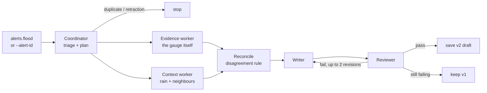

# 07 Agents: the multi-agent advisory writer

The agent layer sits after the forecaster. It takes a forecaster alert (numbers) and writes a
checked, plain-language advisory (version 2) for a duty officer to approve. **Agents draft and check only.** They never
publish to Kafka and never send email, and nothing reaches anyone without a person clicking Approve.

## Two layers

- **Reactive:** the moment an alert lands, the sink writes **v1**, a fixed template with no LLM
  (`alerting/template.py`). It takes seconds and always works.
- **Deliberative:** the agents then build **v2**. If the reviewer passes it, v2 replaces v1 in the console. If an agent,
  a tool or the LLM fails, v1 simply stays. If the officer approves v1 first, timeliness wins.

## The graph (LangGraph, Coordinator–Worker–Delegator)



| Node | Does | Tools (read-only, PostgreSQL) |
|---|---|---|
| Coordinator | loads the alert, drops duplicates and retractions, marks "Update n" for a repeat in the same episode | `get_alert`, `get_episode_history` |
| Evidence worker | stage trend, rise rate, forecast, official levels; says *rising* or *not rising* | `get_recent_windows`, `get_forecast`, `get_official_levels`, `get_past_floods` |
| Context worker | radar rain over the catchment, upstream/downstream gauges, impacts; says *rising* or *not rising* | `get_rain`, `get_neighbours`, `get_gauge_info`, `get_impacts` |
| Reconcile | if the two directions disagree (heavy rain but a flat gauge, or a rising gauge with no rain, which may be a sensor fault), the advisory is marked **UNCERTAIN** and states both signals. One side never wins silently | rules in `agentic_ai/rules.py` |
| Writer | writes the advisory from the facts; with an LLM, the prompt lists every reviewer rule with the exact values | LLM or deterministic text |
| Reviewer | deterministic checks first, then (only with an LLM, and only on a draft that passed) an LLM judgement | `agentic_ai/checks.py` |

**Reviewer checks** (17, in `checks.CHECKS`; each one is also a numbered writer instruction with the exact values):

- every number comes from the evidence, with stages and rates to 0.1 ft;
- the alert's official category is named with its official stage, and so is the highest category the forecast
  crosses ("forecast to reach MAJOR (13.0 ft)");
- no certainty phrases ("will flood");
- probability as a whole % or "not available" (the baseline gives none), plus the horizon and lead time in hours or
  "not available";
- "rain data not available" when radar rain is missing, and never null, None, NaN or "?";
- no Markdown;
- a `SIMULATION` label on replayed data and none on live data;
- the provisional-data note;
- both signals named when UNCERTAIN;
- at most 900 characters.

A failed draft goes back to the writer with reasons, at most twice. **Numbers are anchored to the alert's own window**:
the window the alert was raised on, not the newest one in the database. A replay stamps alerts with wall-clock time,
so "latest window" would be the end of the replay.

**Thresholds** (in `rules.py`): evidence says rising at 0.3 ft/h or more, or when the forecast reaches the category.
Context says rising with 10 mm or more of rain in 3 h, or an upstream rise of 0.5 ft or more in 3 h. When there is neither radar rain nor an upstream reading, context is *unknown* and never counts as a
disagreement. Until rain is streamed into the pipeline (S2), only replayed or seeded data carries rain.

**Logged for evaluation:** every step writes `agent_events` (start, end, tool_call, verdict, disagreement, revision) and
`agent_runs`. The view `agent_run_summary` gives duration, tool calls and review rounds per run. The console's
**Agents** tab shows the graph and the last run from these tables ([04](04-console-tour.md#agents)).

## Run it

```powershell
python -m agentic_ai.seed                                                   # optional: the May 2019 DRWT2 record, no Kafka needed
python -m agentic_ai.run --alert-id "08158700|major|2019-05-04T01:00:00Z"   # one alert; --force to re-run
python -m agentic_ai.run                                                    # consumer group `agent` on alerts.flood
```

The seed writes the **measured** USGS record for DRWT2 and two neighbouring gauges (2 to 5 May 2019), put through the
pipeline's own window and forecast code. These are the same rows a replay writes, marked SIMULATION, with no radar rain
joined. `--drop-illustrative` removes rows an older, illustrative version of the seed wrote. `--dsn` points at another
database, and `run --quiet` hides the per-step lines.

One line is printed per step as it happens, then the advisory and a summary. With `LLM_PROVIDER=none` (verified here
on a scratch PostgreSQL 16, 31 Oct 2026):

```
LLM_PROVIDER=none  LangSmith tracing: off
[  0.04s] coordinator plan evidence -> context -> writer -> reviewer; update 1; SIMULATION; URGENT (13 ms)
[  0.06s] evidence    rising: stage 8.2 ft, rate 5.5 ft/h, forecast 24.7 ft (16 ms)
[  0.07s] context     unknown: rain data not available, 4 neighbour gauge(s) (20 ms)
[  0.08s] writer      attempt 1/3: template text, 726 chars, 0 tokens (10 ms)
[  0.08s] reviewer    attempt 1/3: PASS
[  0.09s] coordinator saved 08158700|major|2019-05-04T01:00:00Z|2 (normal)

SIMULATION: replayed historical data, not a real event.
Onion Creek near Driftwood: forecast to reach MAJOR flood stage (13.0 ft) within 3 h.
Gauge now: 8.2 ft, changing +5.5 ft/h, already above MODERATE (as of 2019-05-04T02:00:00Z).
Forecast: 24.7 ft in 3 h; probability of reaching MAJOR: not available (rise_rate model gives none). ...
...
advisory 08158700|major|2019-05-04T01:00:00Z|2  version 2  outcome saved (normal, reviewer pass after 1/3 attempt(s))  tokens 0  33 events  0.09 s
```

A second run without `--force` prints `dropped: duplicate: v2 exists (...)`. With Groq you see `writer attempt 1/3:
groq openai/gpt-oss-120b, ... tokens`. If Groq fails, the run tries `LLM_FALLBACK` once and then falls back to the
template text. With LangSmith on, the last line is the trace URL.

## LLM providers

Set in `.env` ([02 Setup](02-setup.md#agents-llm)): `LLM_PROVIDER` = `groq` (default, free tier, `GROQ_MODEL` default
`openai/gpt-oss-120b`), `gemini` (Google AI Studio), `ollama` (local `qwen2.5:7b`, offline), or `none` (no LLM,
deterministic, used by every test). Each call has a 30 s timeout and never raises.

## Measured so far

All on the 2019 DRWT2 alert (replay, SIMULATION), Groq `openai/gpt-oss-120b`, runs spaced 65 s apart
(`docs/breadcrumbs/agents.md`, 31 Oct 2026):

| Setting | Runs | Saved, reviewer pass | First attempt | Time per advisory | Tokens per advisory |
|---|---|---|---|---|---|
| reasoning effort not set | 5 | 5/5 | 4/5 (one draft was 917 > 900 characters) | 4.2 to 11.0 s | 4.0k to 8.4k |
| `GROQ_REASONING_EFFORT=low` + abbreviation check | 5 | 5/5 | **5/5**, 0 revisions | **2.6 to 3.9 s** | **3.1k to 3.5k** |

- An abbreviation check was added after "NGS" (for NWS) slipped past both reviewers in 2 of 5 earlier low-effort runs.
  With the check, no slips occurred in the 5 runs above.
- LangSmith: 5/5 traces found, one root run per advisory with every graph node.
- Fallback: back-to-back runs hit Groq's free-tier tokens-per-minute limit (429) on 2 of 5; the template text covered
  both. Gemini `gemini-3.5-flash-lite` as the fallback: one live run saved (attempt 3, 7.0 s).
- `pytest tests/agents`: 122 passed with PostgreSQL 16 and `LLM_PROVIDER=none`. The tests cover disagreement →
  UNCERTAIN, "Update 2" wording, a bad draft sent back, still failing after 2 revisions → v1 kept, and LLM or tool
  failures → v1 kept.
- **Not measured yet:** reviewer catch rate on deliberately corrupted drafts, faithfulness over many alerts, and a
  single-agent vs multi-agent ablation.
- Not built yet: the MCP server (S4), episodic memory beyond "Update n", agent evaluation (faithfulness, reviewer
  catch rate, single-agent vs multi-agent ablation).

Design rationale: `docs/BUILD_PHASES.md`, section "Phase 6b". Interfaces: `docs/CONTRACTS.md`.
