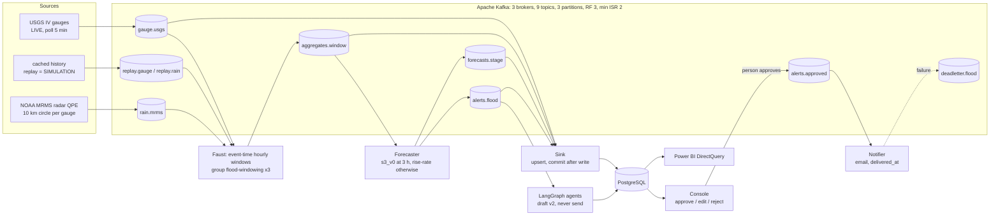

# 1. Method

## 1.1 Problem

River gauges record stage every 5 to 15 minutes, but the public USGS feed transmits readings roughly hourly. One live
sample measured 24 to 69 min between the reading time and its availability [`FAQ.md`, EDA of 3 Oct 2026]. A
flash-flood warning system therefore has to (a) ingest readings as soon as they are published, (b) forecast far
enough ahead to beat that delay, and (c) report how much warning is left after it. DEWS forecasts whether a gauge's
stage will cross an **official NWS flood category** (action, minor, moderate, major, from NOAA NWPS) within a horizon,
and routes every alert through a human approval step before anything is sent.

## 1.2 Architecture (Figure 1)

*Figure 1. DEWS pipeline. Topic and group names: `common/config.py`.*

## 1.3 Ingestion

- **Live producer** (`producers/usgs_iv_producer.py`): polls all 38 gauges every 5 min for the last 6 h, publishes only
  new or revised readings, deduplicated by site, sensor series and timestamp, keyed by `site_no`. It sends one
  heartbeat per gauge per poll and backfills from the last published reading after an outage longer than 6 h
  (verified after a 34 h outage).
- **Replay producer** (`producers/replay_producer.py`): publishes cached history in event-time order to separate topics
  with `mode = SIMULATION`, at a chosen speed.
- **Rain producer** (`producers/mrms_qpe_producer.py`): mean MRMS depth over 5/10/25 km circles
  per gauge. The live default is the RadarOnly product; replay uses Pass 2.
- Producer settings: `acks=all`, idempotence, lz4 (`common/kafka_io.py`).

## 1.4 Stream processing

Faust (faust-streaming 0.11.3) runs one consumer group of three workers, one per partition. Windows are hourly and
tumbling on the reading's own timestamp (`streams/windowing.py`, pure functions):

- a window closes when a later reading arrives, or in live mode when a heartbeat passes window end + 90 min;
- silent hours are zero-filled (`n_readings = 0`, stage carried forward);
- late or revised readings re-emit a window as a revision, up to 3 windows back;
- state lives in Faust tables backed by changelog topics, so a killed worker's partition is rebuilt on another worker.

The same window functions build the ML training rows (`ml/backtest.py`, `ml/s3_model.py`), so offline and online
features match.

## 1.5 Forecast and alert

`streams/forecaster.py` calls `ml.predict.predict()` once per closed window. With `ml/models/active.json` present,
`s3_v0` answers at the 3 h horizon; any other horizon or any error returns the rise-rate extrapolation. The model
details are in [03-results](03-results.md#32-forecaster). An alert is published to `alerts.flood` only when the
forecast reaches an official category above the gauge's current one. Alerts form episodes: `new`, `upgrade` for a
higher category, and `retract` when the forecast falls back before the crossing.

## 1.6 Storage, approval, notification

- **Sink** (`storage/sink.py`): writes readings, windows, forecasts and alerts with idempotent upserts and commits
  Kafka offsets only after the PostgreSQL commit (at least once, effectively once). It writes the template advisory
  (v1) when an alert lands.
- **Agents** (LangGraph, [04-agents](04-agents.md)) may write v2. They read PostgreSQL only and never produce to Kafka
  or send anything.
- **Approval:** a person approves, edits or rejects in the console. Approval publishes to `alerts.approved`, and the
  database change is rolled back if the publish fails (`alerting/approval.py`).
- **Notifier** (`alerting/notifier.py`): the only sender. It reads only `alerts.approved`, retries SMTP 3 times, then
  writes to `deadletter.flood`, and commits after `delivered_at` is stored.

## 1.7 Measurement

Every record carries its timestamps: reading, fetched, ingest, window close, forecast, alert, approved, delivered. The
`latency_waterfall` view reports each stage's delay, live and replay apart, gross and net of feed delay
(`storage/views.sql`). Fault tolerance is measured by `tools/fault_drill.py`, which breaks one component during a
replay, restarts it, times recovery and checks for loss or duplication.

Why Faust and not Kafka Streams: Faust is not a wrapper around Kafka Streams (a Java library); it re-implements the
same ideas in Python (stream processors, state tables backed by changelog topics, windows, co-partitioning, consumer
groups) over the `aiokafka` client. That keeps the stream processor in the same language as the producers, the ML
code and the agents, and lets it share the window functions with the training code.
